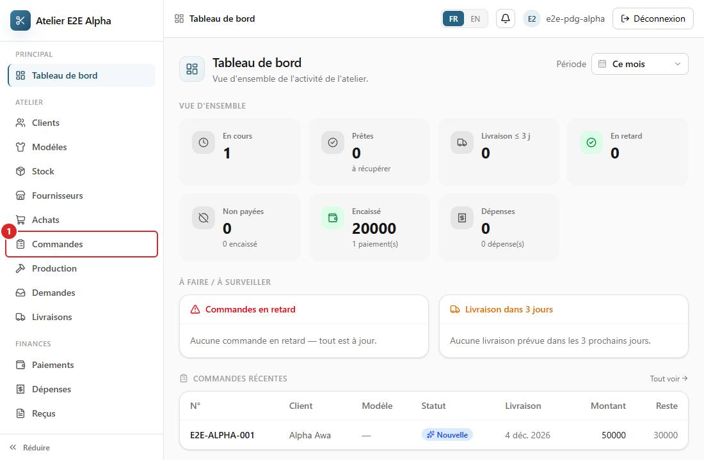
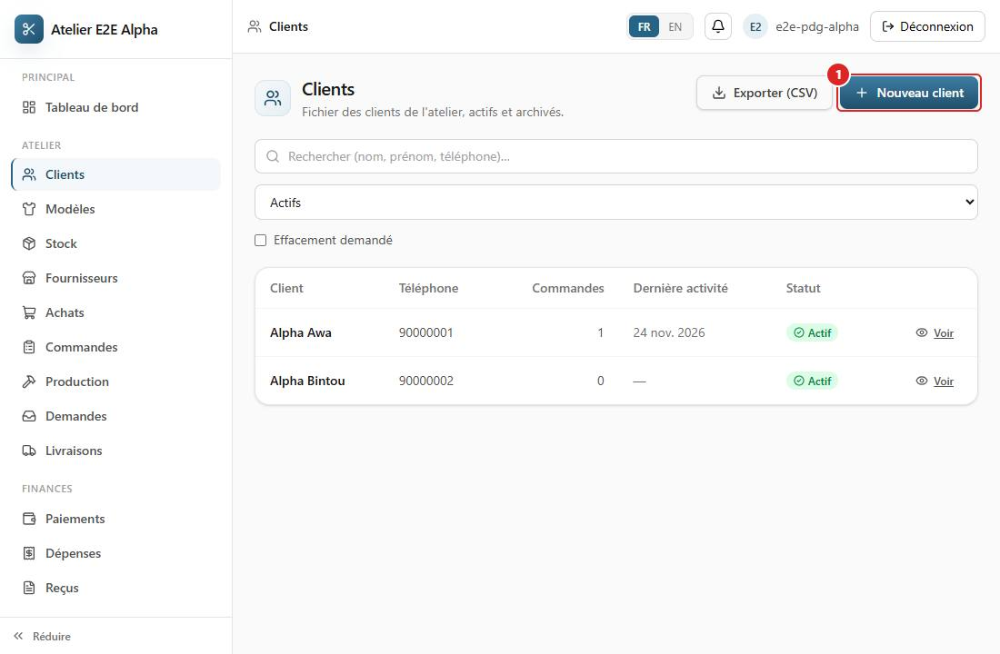
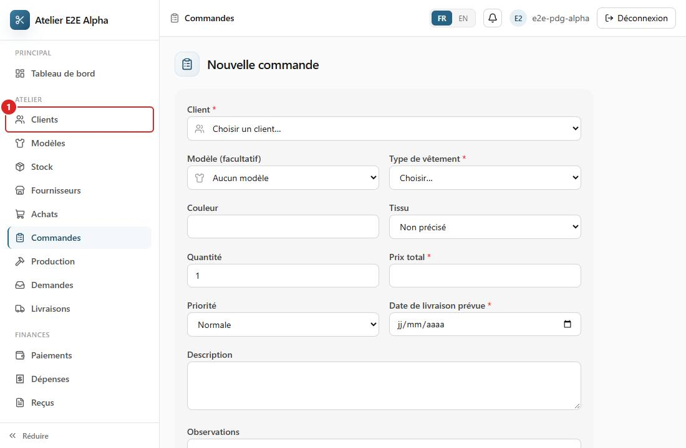
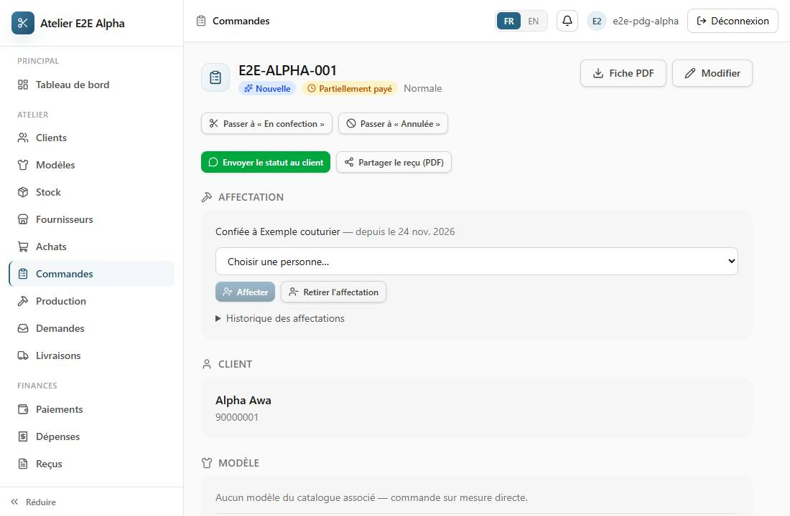
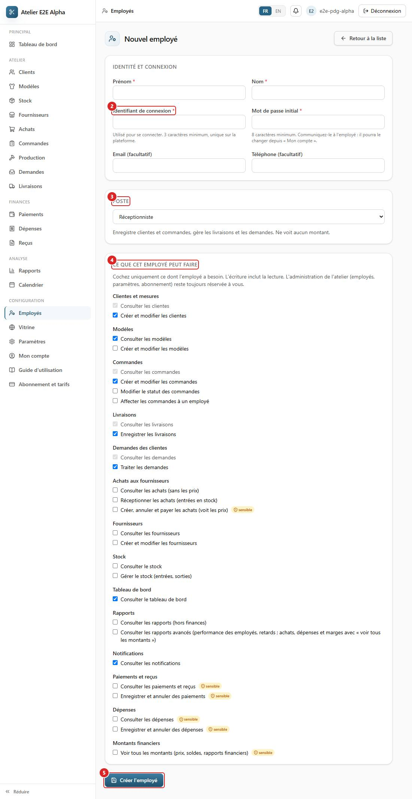
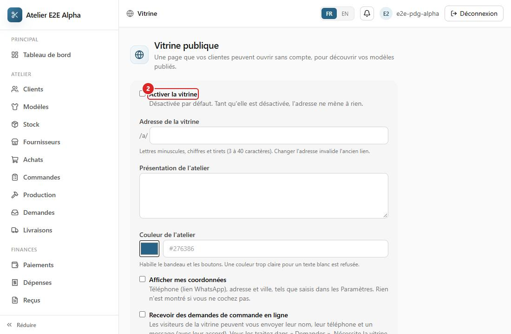
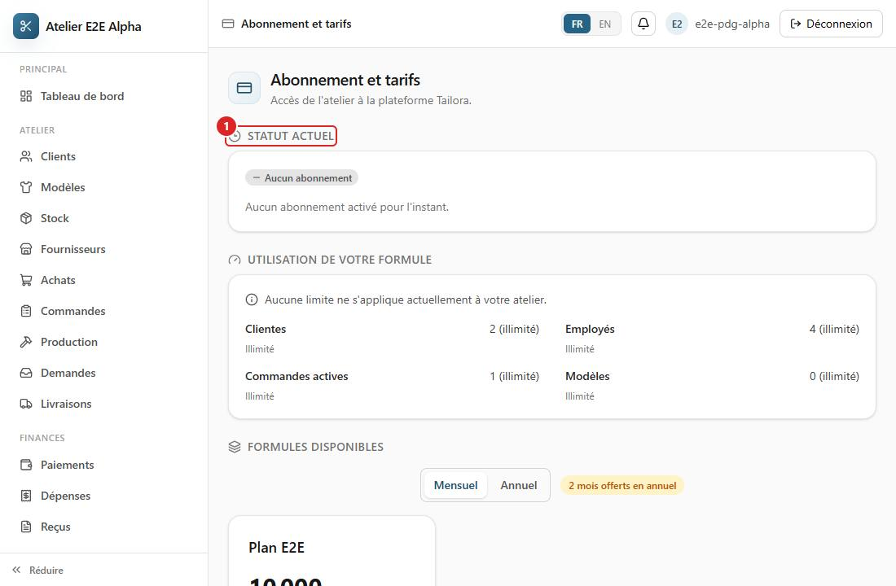

<!-- Fichier généré par `npm run guides:md` à partir du guide intégré à l'application : ne pas le modifier à la main. -->

# Guide du PDG

> Pour le propriétaire d'un atelier : de la création du compte à la gestion de l'équipe et de l'abonnement.

Vous avez tous les droits sur votre atelier. Ce guide suit l'ordre naturel : démarrer, enregistrer vos clientes, vos commandes et vos encaissements, puis organiser votre équipe. Les mots entre guillemets sont les libellés exacts de l'application.

## Sommaire

1. [Démarrer](#1-démarrer)
2. [Vous repérer dans l'application](#2-vous-repérer-dans-lapplication)
3. [Enregistrer vos clientes et leurs mesures](#3-enregistrer-vos-clientes-et-leurs-mesures)
4. [Créer et suivre une commande](#4-créer-et-suivre-une-commande)
5. [Encaisser un paiement et émettre un reçu](#5-encaisser-un-paiement-et-émettre-un-reçu)
6. [Livrer une commande](#6-livrer-une-commande)
7. [Traiter les demandes de commande](#7-traiter-les-demandes-de-commande)
8. [Stock, fournisseurs et achats](#8-stock-fournisseurs-et-achats)
9. [Dépenses, rapports et calendrier](#9-dépenses-rapports-et-calendrier)
10. [Créer et gérer vos employés](#10-créer-et-gérer-vos-employés)
11. [Donner accès à une cliente (espace client)](#11-donner-accès-à-une-cliente-espace-client)
12. [Votre vitrine publique](#12-votre-vitrine-publique)
13. [Votre abonnement](#13-votre-abonnement)
14. [Paramètres de l'atelier et mot de passe](#14-paramètres-de-latelier-et-mot-de-passe)

## 1. Démarrer

Créez votre atelier une seule fois ; vous bénéficiez de 15 jours d'essai gratuit avec accès complet.

1. Sur la page de connexion, cliquez sur « Créer votre atelier ». Renseignez « Nom de l'atelier », « Prénom », « Nom » et « Email » (il sert aussi d'identifiant de connexion), choisissez un mot de passe d'au moins 8 caractères et confirmez-le, puis cliquez sur « Créer mon compte ».
   - **Résultat attendu :** Votre atelier est créé et vous arrivez directement dans l'application.
2. Les fois suivantes, ouvrez la page de connexion, saisissez « Identifiant » (votre adresse email) et « Mot de passe », puis cliquez sur « Se connecter ». En cas d'oubli, cliquez sur « Mot de passe oublié ? » : un lien de réinitialisation est envoyé à l'adresse email associée au compte.
   - **Résultat attendu :** Vous arrivez sur votre tableau de bord.
3. Si un bandeau vous demande de confirmer votre email, ouvrez le message reçu et cliquez sur le lien. Le bandeau propose « Renvoyer l'email » si le message ne vous est pas parvenu.
   - **Résultat attendu :** Votre adresse est confirmée et le bandeau disparaît.

## 2. Vous repérer dans l'application

Le menu de gauche (ordinateur) regroupe les écrans par domaine : atelier, finances, analyse et configuration.

1. Cliquez sur une entrée du menu, par exemple « Commandes », pour ouvrir l'écran correspondant. Le bouton de réduction en bas du menu le transforme en barre d'icônes pour gagner de la place.
   - **Résultat attendu :** L'écran s'ouvre et son titre s'affiche en haut de la page.
2. Sur téléphone, la barre du bas donne accès à l'accueil, aux clients, aux modèles, aux commandes et aux finances. Les autres écrans (stock, production, livraisons, employés, abonnement…) sont dans le menu ouvert par le bouton en haut à gauche (« Ouvrir le menu »).
   - **Résultat attendu :** Tous les écrans restent accessibles, sur ordinateur comme sur téléphone.
3. La cloche de l'en-tête ouvre « Notifications » : ce sont des alertes automatiques (commandes en retard, commandes prêtes, livraisons proches, impayés, stock bas, achats en retard). Une pastille rouge indique le nombre d'alertes non lues ; sélectionnez-en puis cliquez sur « Marquer comme lues », ou utilisez « Marquer lue » sur une alerte.
   - **Résultat attendu :** La pastille diminue à mesure que vous marquez les alertes comme lues.
4. Le bouton FR / EN de l'en-tête change la langue de l'interface. Votre choix est enregistré sur votre compte : vous le retrouvez à la prochaine connexion. Vous pouvez aussi le modifier dans « Mon compte », rubrique « Langue ».
   - **Résultat attendu :** Tous les écrans et les messages envoyés s'affichent dans la langue choisie.

## 3. Enregistrer vos clientes et leurs mesures

Une commande ne peut être créée que pour une cliente qui a déjà des mesures.

1. Ouvrez « Clients ». Pour retrouver quelqu'un, saisissez son nom, prénom ou téléphone dans la barre de recherche. Cliquez sur « Nouveau client » pour en ajouter un.
   - **Résultat attendu :** La liste affiche vos clientes ; chaque ligne mène à sa fiche.
2. Renseignez « Nom », « Prénom » et le téléphone (les autres champs sont facultatifs), puis cliquez sur « Enregistrer ». Ajoutez l'email si vous voulez pouvoir lui envoyer l'invitation à son espace client.
   - **Résultat attendu :** La fiche de la cliente s'ouvre.
3. Sur la fiche, cliquez sur « Nouvelle mesure ». Saisissez les mesures en centimètres (toutes sont facultatives), puis enregistrez. Chaque prise de mesures crée un nouvel enregistrement : l'historique reste consultable sur la fiche.
   - **Résultat attendu :** La fiche affiche les mesures ; vous pouvez maintenant créer une commande pour cette cliente.

## 4. Créer et suivre une commande

1. Ouvrez « Commandes » puis cliquez sur « Nouvelle commande ». Choisissez le « Client », puis le « Modèle (facultatif) » si la commande suit un modèle du catalogue. Renseignez le « Type de vêtement », le « Prix total », la « Priorité » et la « Date de livraison prévue ». Pour encaisser un acompte tout de suite, cochez « Encaisser un paiement initial maintenant ». Cliquez sur « Enregistrer ».
   - **Résultat attendu :** La commande est créée au statut « Nouvelle » ; sa fiche s'affiche avec le prix, l'encaissé et le reste à payer.
2. Ouvrez la commande depuis la liste. Dans sa fiche, le bouton « Passer à … » fait avancer le statut : « Nouvelle », « En confection », « Essayage », « Retouches », puis « Terminée ». Une commande peut aussi être annulée avec un motif obligatoire.
   - **Résultat attendu :** Le statut change et la cliente connectée à son espace voit l'avancement.
3. Ouvrez « Production » pour savoir qui travaille sur quoi. Dans la fiche d'une commande, section « Affectation », choisissez une personne avec « Choisir une personne… » puis cliquez sur « Affecter ». « Retirer l'affectation » annule l'affectation.
   - **Résultat attendu :** La commande apparaît dans les travaux de la personne choisie, et elle reçoit une alerte.

## 5. Encaisser un paiement et émettre un reçu

Les paiements s'enregistrent depuis la fiche de la commande : l'écran Paiements est l'historique.

1. Ouvrez la commande, descendez à la section « Paiements ». Saisissez le montant, choisissez le mode (espèces, Mobile Money, virement…), ajoutez une référence si vous en avez une, puis cliquez sur « Ajouter le paiement ». Impossible sur une commande annulée.
   - **Résultat attendu :** Le paiement apparaît dans la liste, et l'encaissé et le reste à payer sont mis à jour.
2. Dans la même fiche, cliquez sur « Émettre un reçu » à côté du paiement, ou sur « Émettre un reçu récapitulatif » pour un reçu récapitulatif de la commande. Retrouvez tous les reçus dans « Reçus » : ouvrez le PDF pour le télécharger ou l'imprimer.
   - **Résultat attendu :** Un reçu numéroté est émis ; la cliente le retrouve aussi dans son espace.
3. Ouvrez « Paiements » pour voir tous les encaissements, toutes commandes confondues. Filtrez par mode, par période ou cherchez par commande, client ou référence.
   - **Résultat attendu :** Vous retrouvez rapidement un encaissement.

## 6. Livrer une commande

1. La livraison n'est possible que lorsque la commande est au statut « Terminée » : passez-la à ce statut depuis sa fiche.
   - **Résultat attendu :** La section de livraison s'ouvre dans la fiche.
2. Dans la fiche, section « Livraison », ajoutez un « Commentaire » si besoin. S'il reste un solde, cochez « Encaisser un paiement final au retrait » et saisissez le montant. Cliquez sur « Enregistrer la livraison ». L'historique de toutes les remises est dans « Livraisons ».
   - **Résultat attendu :** La commande passe à « Livrée » et la livraison est datée.

## 7. Traiter les demandes de commande

Les demandes viennent de l'espace client et de la vitrine publique.

1. Ouvrez « Demandes » et cliquez sur une demande en attente pour lire la description, le modèle souhaité et les coordonnées.
   - **Résultat attendu :** Le détail de la demande s'affiche avec la section « Traiter la demande ».
2. Accepter une demande ne crée pas la commande : créez-la d'abord par « Nouvelle commande » (voir plus haut), puis, dans la demande, choisissez-la avec « Lier à une commande existante » et cliquez sur « Accepter et lier ». Si la demande vient de la vitrine et que la personne n'a pas encore de fiche, cliquez d'abord sur « Créer la fiche cliente ».
   - **Résultat attendu :** La demande passe à « Acceptée » et la cliente est prévenue.
3. Pour décliner, cliquez sur « Refuser cette demande », indiquez si vous le souhaitez le « Motif du refus (optionnel) » puis cliquez sur « Confirmer le refus ».
   - **Résultat attendu :** La demande passe à « Refusée » avec le motif, visible de la cliente.
4. Pour recevoir des demandes de visiteurs sans compte, activez-les dans « Vitrine » (voir « Votre vitrine publique »). Sans suite, une demande de visiteur est effacée automatiquement.
   - **Résultat attendu :** Les demandes de la vitrine arrivent dans la même liste, avec un badge « Vitrine ».

## 8. Stock, fournisseurs et achats

1. Ouvrez « Stock » puis « Nouvel article ». Renseignez le nom, la catégorie, l'unité, le « Seuil d'alerte » (vous êtes alerté quand la quantité descend à ce niveau) et la « Quantité initiale ».
   - **Résultat attendu :** L'article apparaît dans la liste ; la quantité initiale est enregistrée comme premier mouvement.
2. Dans la fiche d'un article, section « Mouvement », choisissez « Entrée » ou « Sortie », saisissez la quantité (et le « Motif », obligatoire pour une sortie), puis cliquez sur « Enregistrer l'entrée » ou « Enregistrer la sortie ».
   - **Résultat attendu :** La quantité en stock est mise à jour et le mouvement est ajouté à l'historique avec son auteur.
3. Ouvrez « Fournisseurs » puis « Nouveau fournisseur » pour enregistrer chez qui vous achetez tissus et fournitures.
   - **Résultat attendu :** Le fournisseur est disponible lors de la création d'un achat.
4. Ouvrez « Achats » puis « Nouvel achat ». Choisissez le fournisseur, la « Date de livraison attendue », ajoutez chaque article avec « Ajouter un article » (quantité et prix unitaire), puis cliquez sur « Enregistrer l'achat ».
   - **Résultat attendu :** L'achat est enregistré comme « À recevoir » et suivi dans la liste.
5. À l'arrivée de la marchandise, ouvrez l'achat, saisissez dans « Reçu maintenant » la quantité reçue (ou cliquez sur « Tout recevoir ») puis sur « Enregistrer la réception ».
   - **Résultat attendu :** Le stock augmente automatiquement ; l'achat devient « Partiellement reçu » ou « Reçu ».
6. Pour régler l'achat, cliquez sur « Enregistrer le paiement » puis confirmez avec « Oui, enregistrer ». « Annuler l'achat » est possible tant que rien n'est reçu ni payé.
   - **Résultat attendu :** Une dépense « Achats fournisseurs » du même montant est créée automatiquement.

## 9. Dépenses, rapports et calendrier

1. Ouvrez « Dépenses » puis « Nouvelle dépense ». Renseignez la « Catégorie », le « Montant » et, si besoin, la « Date » (la date du jour sinon) et une « Description », puis enregistrez.
   - **Résultat attendu :** La dépense apparaît dans la liste et dans le résultat de trésorerie.
2. Ouvrez « Rapports » pour suivre vos finances : choisissez la « Période », puis consultez « Encaissé », « Dépenses » et « Solde de trésorerie ». Ce n'est pas un bénéfice comptable : c'est l'encaissé moins les dépenses.
   - **Résultat attendu :** Les chiffres suivent la période choisie.
3. Ouvrez « Calendrier » : les commandes y sont placées à leur date de livraison prévue. Cliquez sur un jour pour voir ses commandes ou en créer une.
   - **Résultat attendu :** Vous voyez d'un coup d'œil les jours chargés.

## 10. Créer et gérer vos employés

Seul le PDG gère les employés, les paramètres et l'abonnement : ces droits ne se délèguent pas.

1. Ouvrez « Employés ». La liste montre le poste, le statut et le nombre de droits de chacun. Cliquez sur « Nouvel employé » pour ajouter quelqu'un.
   - **Résultat attendu :** Le formulaire de création s'ouvre.
2. Dans « Identité et connexion », renseignez « Prénom », « Nom », un « Identifiant de connexion » (3 caractères minimum, unique sur la plateforme) et un « Mot de passe initial » (8 caractères minimum). Communiquez ces deux informations à l'employé : il pourra changer son mot de passe dans « Mon compte ».
   - **Résultat attendu :** L'employé pourra se connecter avec cet identifiant.
3. Dans « Poste », choisissez un poste (couturier, réceptionniste, magasinier, comptable, autre) puis cliquez sur « Appliquer les droits de ce poste » : cela coche les droits habituels du poste. Le poste est un modèle de départ : il ne donne aucun droit par lui-même.
   - **Résultat attendu :** Les droits du poste sont cochés ; vous pouvez les ajuster.
4. Dans « Ce que cet employé peut faire », cochez uniquement ce dont l'employé a besoin : l'écriture inclut la lecture. Les droits qui donnent accès à l'argent portent la mention « sensible » : en les accordant, l'application vous demande de saisir « Votre mot de passe (confirmation) ».
   - **Résultat attendu :** L'employé ne verra que les écrans qui correspondent aux droits cochés.
5. Cliquez sur « Créer l'employé ».
   - **Résultat attendu :** Le message « Employé créé. » s'affiche et l'employé peut se connecter.
6. Pour modifier un employé, cliquez sur « Gérer » sur sa ligne. Changer de poste ne retire pas les droits déjà accordés : vérifiez-les. « Réinitialiser le mot de passe » ferme ses sessions ouvertes ; « Désactiver le compte » l'empêche de se connecter sans rien supprimer, et « Réactiver le compte » annule cette décision.
   - **Résultat attendu :** Les changements sont immédiats : l'employé est déconnecté s'il est désactivé.

## 11. Donner accès à une cliente (espace client)

1. Ouvrez la fiche de la cliente et cliquez sur « Inviter ce client », puis sur « Confirmer l'invitation ». Si la fiche contient un email, le lien d'invitation lui est envoyé ; sinon l'application affiche le lien : cliquez sur « Copier » et transmettez-le vous-même (WhatsApp, SMS…).
   - **Résultat attendu :** Un compte client est créé ; la fiche indique « Compte client actif » une fois le compte activé.
2. Le lien d'invitation est personnel, à usage unique et valable 7 jours. Passé ce délai, ou si la cliente l'a perdu, renouvelez l'invitation depuis sa fiche.
   - **Résultat attendu :** La cliente choisit son mot de passe et accède à son espace avec son numéro de téléphone.
3. Une cliente peut fermer son compte et demander l'effacement de ses données personnelles. La fiche affiche alors « Cette cliente a fermé son compte et demandé l'effacement de ses données. » : cliquez sur « Anonymiser cette cliente » puis « Anonymiser définitivement ». Son identité (nom, téléphone, mesures…) est effacée définitivement ; les commandes et paiements restent dans votre comptabilité, sans son identité.
   - **Résultat attendu :** La fiche est anonymisée ; cette action est irréversible.

## 12. Votre vitrine publique

Une page ouverte à tous, sans compte, qui présente vos modèles publiés. Elle est désactivée par défaut.

1. Dans la fiche d'un modèle, ajoutez des photos, puis cliquez sur « Publier dans le lookbook ». Seuls les modèles publiés sont montrés : jamais de prix ni de donnée de cliente.
   - **Résultat attendu :** Le modèle indique « Publié : ce modèle peut être montré aux clientes. ».
2. Ouvrez « Vitrine », cochez « Activer la vitrine », choisissez l'« Adresse de la vitrine » (lettres minuscules, chiffres et tirets), rédigez la « Présentation de l'atelier » et, si vous le souhaitez, cochez « Afficher mes coordonnées » et « Recevoir des demandes de commande en ligne ». Enregistrez.
   - **Résultat attendu :** Le message « Enregistré. » s'affiche et la vitrine est en ligne.
3. Cliquez sur « Copier le lien » pour copier l'adresse, ou sur « Ouvrir » pour la visiter. Changer l'adresse invalide l'ancien lien.
   - **Résultat attendu :** Vous pouvez partager l'adresse à vos clientes.

## 13. Votre abonnement

L'essai gratuit dure 15 jours. Ensuite, l'accès se poursuit avec un abonnement payé hors de l'application et vérifié par la plateforme.

1. Ouvrez « Abonnement et tarifs ». « Statut actuel » indique votre situation (essai gratuit, actif, expiré…), la formule, l'expiration et les jours restants. Les formules disponibles et leurs prix mensuel et annuel sont listés plus bas, avec une foire aux questions.
   - **Résultat attendu :** Vous savez jusqu'à quand votre accès est assuré.
2. Au-dessus de la liste des formules, choisissez la période « Mensuel » ou « Annuel », puis cliquez sur « Souscrire » sur la formule voulue. Lisez « Comment payer » : ce sont les instructions de la plateforme (numéro de paiement mobile, compte…). Effectuez le paiement en dehors de l'application.
   - **Résultat attendu :** Vous avez payé et gardez la référence de la transaction.
3. De retour sur la page, choisissez le « Moyen de paiement », l'« Opérateur » si demandé, saisissez la « Référence du paiement » (numéro de transaction du SMS ou du relevé, 3 caractères minimum) puis cliquez sur « Déclarer mon paiement ».
   - **Résultat attendu :** Le message « Paiement déclaré. La plateforme va le vérifier ; vous serez prévenu par courriel. » s'affiche. Aucun accès supplémentaire n'est accordé avant la vérification.
4. Tant que la plateforme n'a pas vérifié, le paiement reste « En attente » et vous ne pouvez pas en déclarer un autre ; « Retirer ma déclaration » annule la déclaration. Une fois « Confirmé », l'abonnement est activé, vous recevez un courriel et pouvez ouvrir le justificatif avec « Télécharger ». Un paiement « Rejeté » affiche son motif.
   - **Résultat attendu :** L'abonnement commence maintenant, ou à l'échéance de l'abonnement en cours si vous renouvelez avant la fin : aucun jour n'est perdu.
5. Quand l'essai ou l'abonnement se termine, vous gardez l'accès complet pendant quelques jours de grâce (bandeau d'avertissement), puis l'atelier passe en lecture seule : vous consultez et exportez vos données, sans en créer de nouvelles. Rien n'est supprimé. Un nouvel abonnement rétablit l'accès. Pour une question, cliquez sur « Contacter l'administrateur ».
   - **Résultat attendu :** Vos données restent intactes, quelle que soit la situation de l'abonnement.

## 14. Paramètres de l'atelier et mot de passe

1. Ouvrez « Paramètres » : modifiez le « Nom de l'atelier », la « Devise », le « Slogan » et le « Logo » de l'atelier. La rubrique « Reçus & informations de paiement » permet d'ajouter des lignes « Clé : Valeur » (numéro de paiement mobile, RIB, mentions légales…) qui figureront sur chaque reçu PDF. Choisissez aussi le « Thème » clair ou sombre.
   - **Résultat attendu :** Le message « Enregistré. » s'affiche et les prochains reçus tiennent compte des changements.
2. Ouvrez « Mon compte ». Choisissez la « Langue » ; pour changer de mot de passe, saisissez « Mot de passe actuel », le nouveau mot de passe et sa confirmation.
   - **Résultat attendu :** Le message « Mot de passe modifié. » s'affiche.
