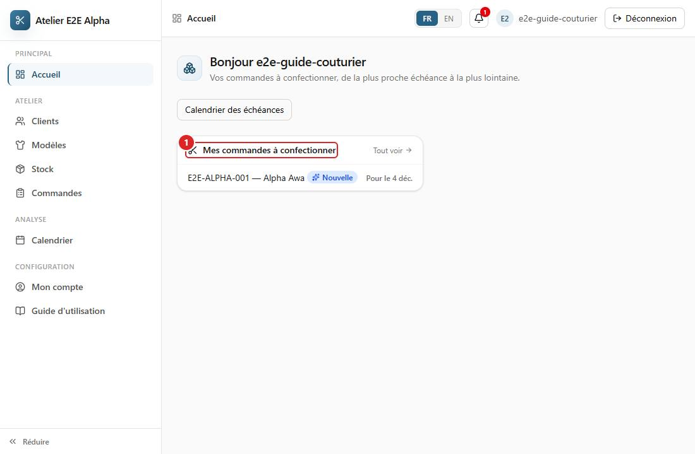
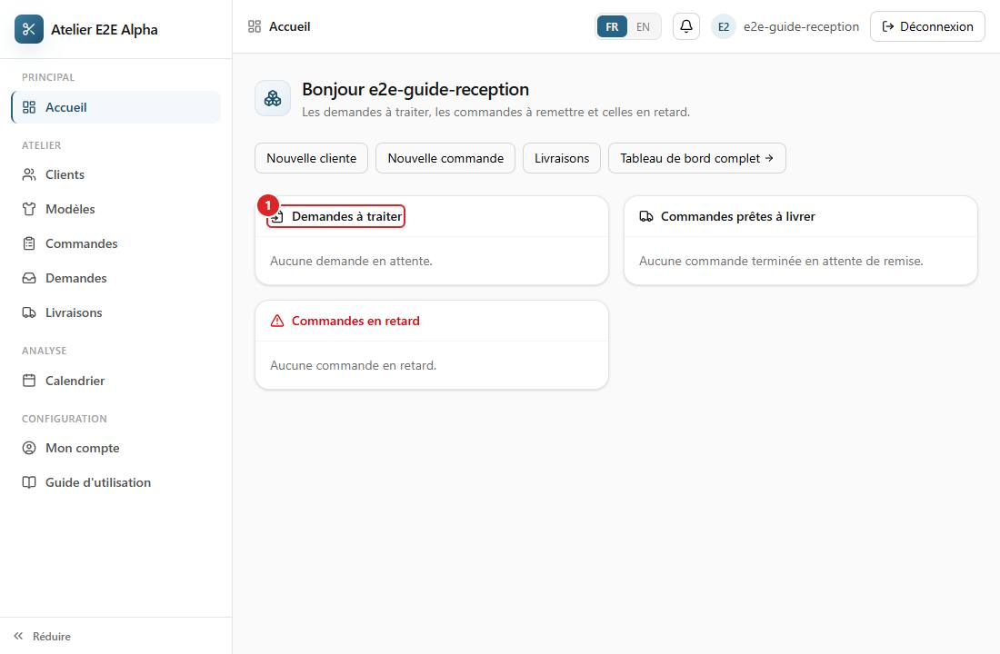
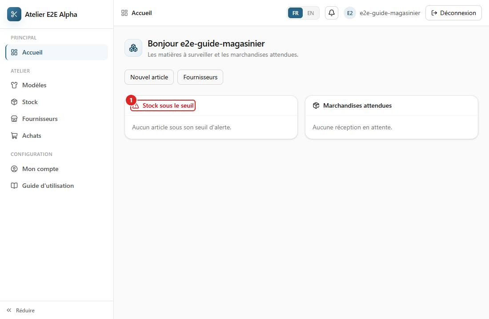
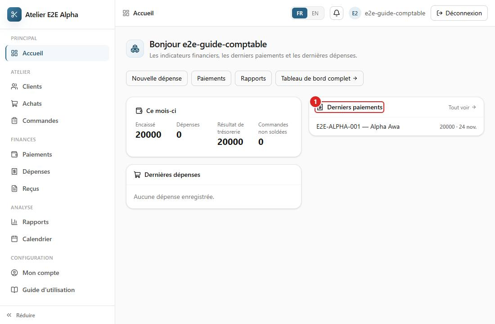

<!-- Fichier généré par `npm run guides:md` à partir du guide intégré à l'application : ne pas le modifier à la main. -->

# Guide de l'employé

> Pour les membres de l'équipe d'un atelier : couturier, réceptionniste, magasinier, comptable ou autre poste.

Votre responsable (le PDG) vous a créé un compte avec un identifiant et un mot de passe. Ce guide ne montre que ce que vos droits vous permettent de faire : si un écran n'apparaît pas dans votre menu, c'est que votre compte n'y a pas accès. Les mots entre guillemets sont les libellés exacts de l'application.

> Dans l'application, un employé ne voit que les sections et étapes qui correspondent à ses droits ; ce document les présente toutes, avec les droits nécessaires.

## Sommaire

1. [Bien commencer](#1-bien-commencer)
2. [Couturier : vos commandes à confectionner](#2-couturier-vos-commandes-à-confectionner)
3. [Réceptionniste : clientes et commandes](#3-réceptionniste-clientes-et-commandes)
4. [Réceptionniste : demandes de commande](#4-réceptionniste-demandes-de-commande)
5. [Réceptionniste : remettre une commande](#5-réceptionniste-remettre-une-commande)
6. [Magasinier : stock, fournisseurs et réceptions](#6-magasinier-stock-fournisseurs-et-réceptions)
7. [Comptable : paiements, dépenses et rapports](#7-comptable-paiements-dépenses-et-rapports)
8. [Poste « Autre »](#8-poste-autre)

## 1. Bien commencer

*Droits nécessaires :* Consulter les notifications

1. Ouvrez la page de connexion, saisissez l'identifiant et le mot de passe donnés par votre responsable, puis cliquez sur « Se connecter ». Vous arrivez sur votre accueil, l'espace de travail de votre poste. Le menu ne propose que les écrans auxquels vous avez droit.
   - **Résultat attendu :** Votre accueil s'affiche avec les informations utiles à votre travail.
2. Vos droits sont réglés individuellement par le PDG : deux personnes au même poste peuvent donc voir des écrans différents. Si vous avez besoin d'un écran absent de votre menu, demandez-le à votre responsable. En cas de message de refus d'accès, c'est aussi une question de droits.
   - **Résultat attendu :** Vous savez à qui vous adresser quand il vous manque un accès.
3. La cloche de l'en-tête ouvre « Notifications » : ce sont des alertes automatiques qui vous concernent. Une pastille rouge indique les alertes non lues ; sélectionnez-en puis cliquez sur « Marquer comme lues », ou utilisez « Marquer lue » sur une alerte.
   - **Résultat attendu :** La pastille diminue à mesure que vous lisez vos alertes.
4. Ouvrez « Mon compte » : choisissez la « Langue » et, pour changer de mot de passe, saisissez « Mot de passe actuel », le nouveau mot de passe et sa confirmation. Le bouton FR / EN de l'en-tête change aussi la langue ; elle est enregistrée sur votre compte.
   - **Résultat attendu :** Le message « Mot de passe modifié. » s'affiche après un changement de mot de passe.
5. Si l'abonnement de l'atelier est terminé, un bandeau s'affiche et l'atelier passe en lecture seule : vous pouvez tout consulter, mais plus rien enregistrer. Prévenez votre responsable ; aucune donnée n'est perdue.
   - **Résultat attendu :** Dès que l'abonnement est renouvelé, vous retrouvez toutes vos possibilités.

## 2. Couturier : vos commandes à confectionner

Votre accueil liste les commandes qui vous sont confiées, de l'échéance la plus proche à la plus lointaine.

*Droits nécessaires :* Modifier le statut des commandes

1. Sur l'accueil, repérez la section « Mes commandes à confectionner ». Les commandes en retard portent la mention « En retard ». Cliquez sur une commande pour l'ouvrir.
   - **Résultat attendu :** La fiche de la commande s'ouvre.
2. Pour voir toutes les commandes, ouvrez « Commandes » : filtrez par statut ou par priorité, ou cherchez par numéro ou par client. Dans la fiche, lisez le modèle, le tissu, la couleur, la description et la « Livraison prévue ».
   - **Résultat attendu :** Vous avez tout ce qu'il faut pour confectionner le vêtement.
3. Dans la fiche de la commande, la section « Mesures du client » affiche les mesures de la cliente ; « Historique complet » ouvre toutes ses prises de mesures.
   - **Résultat attendu :** Vous avez les mesures sous les yeux.
4. Quand vous avancez dans le travail, cliquez sur le bouton « Passer à … » de la fiche : « En confection » quand vous commencez, « Essayage » quand la cliente doit essayer, « Retouches » s'il y a des corrections, puis « Terminée » quand le vêtement est prêt.
   - **Résultat attendu :** Le statut change ; la réception voit la commande prête à livrer et la cliente suit l'avancement.

## 3. Réceptionniste : clientes et commandes

Votre accueil montre les demandes à traiter, les commandes prêtes à livrer et celles en retard.

*Droits nécessaires :* Créer et modifier les clientes ; Créer et modifier les commandes

1. Sur l'accueil, consultez « Demandes à traiter », « Commandes prêtes à livrer » et « Commandes en retard ». « Tout voir » ouvre la liste complète.
   - **Résultat attendu :** Vous savez ce qui demande votre attention aujourd'hui.
2. Ouvrez « Clients » puis « Nouveau client ». Renseignez « Nom », « Prénom » et le téléphone, puis cliquez sur « Enregistrer ».
   - **Résultat attendu :** La fiche de la cliente s'ouvre.
3. Sur la fiche, cliquez sur « Nouvelle mesure », saisissez les mesures en centimètres (toutes facultatives) et enregistrez. Sans mesures, la commande ne peut pas être créée.
   - **Résultat attendu :** Les mesures figurent sur la fiche.
4. Ouvrez « Commandes » puis « Nouvelle commande ». Choisissez le « Client », renseignez le « Type de vêtement », la « Date de livraison prévue » et les détails utiles, puis cliquez sur « Enregistrer ».
   - **Résultat attendu :** La commande est créée au statut « Nouvelle ». L'encaissement relève de la personne qui a le droit d'enregistrer les paiements.

## 4. Réceptionniste : demandes de commande

*Droits nécessaires :* Consulter les demandes ; Traiter les demandes ; Consulter les commandes

1. Ouvrez « Demandes » et cliquez sur une demande en attente pour lire la description et les coordonnées.
   - **Résultat attendu :** Le détail s'affiche avec la section « Traiter la demande ».
2. Accepter une demande ne crée pas la commande : créez-la d'abord par « Nouvelle commande », puis, dans la demande, choisissez-la avec « Lier à une commande existante » et cliquez sur « Accepter et lier ».
   - **Résultat attendu :** La demande passe à « Acceptée » et la cliente est prévenue.
3. Pour décliner, cliquez sur « Refuser cette demande », indiquez le « Motif du refus (optionnel) » si vous le souhaitez, puis « Confirmer le refus ».
   - **Résultat attendu :** La demande passe à « Refusée » avec le motif.

## 5. Réceptionniste : remettre une commande

*Droits nécessaires :* Enregistrer les livraisons ; Consulter les commandes

1. Les commandes terminées en attente de remise sont sur l'accueil, dans « Commandes prêtes à livrer ». L'historique des remises est dans « Livraisons ».
   - **Résultat attendu :** Vous retrouvez les commandes à remettre.
2. Ouvrez la commande : la livraison n'est possible qu'au statut « Terminée ». Dans la section « Livraison », ajoutez un « Commentaire » si besoin, puis cliquez sur « Enregistrer la livraison ». Si un solde reste dû, la personne autorisée à encaisser enregistre le paiement.
   - **Résultat attendu :** La commande passe à « Livrée » et la remise est datée.

## 6. Magasinier : stock, fournisseurs et réceptions

Votre accueil montre le stock sous le seuil et les marchandises attendues. Les prix sont masqués sauf droit spécial.

*Droits nécessaires :* Gérer le stock (entrées, sorties) ; Créer et modifier les fournisseurs ; Réceptionner les achats (entrées en stock)

1. Sur l'accueil, la section « Stock sous le seuil » liste les articles à réapprovisionner. Cliquez sur un article pour voir sa fiche.
   - **Résultat attendu :** Vous savez quoi commander en priorité.
2. Ouvrez « Stock » puis « Nouvel article ». Renseignez le nom, la catégorie, l'unité, le « Seuil d'alerte » et la « Quantité initiale », puis enregistrez.
   - **Résultat attendu :** L'article apparaît dans la liste.
3. Dans la fiche d'un article, section « Mouvement », choisissez « Entrée » ou « Sortie », saisissez la quantité (et le « Motif », obligatoire pour une sortie), puis cliquez sur « Enregistrer l'entrée » ou « Enregistrer la sortie ».
   - **Résultat attendu :** La quantité est mise à jour et le mouvement est ajouté à l'historique, avec votre nom.
4. Ouvrez « Fournisseurs » puis « Nouveau fournisseur » pour ajouter un fournisseur (nom, contact, téléphone).
   - **Résultat attendu :** Le fournisseur est enregistré.
5. À l'arrivée d'une marchandise, ouvrez « Achats », ouvrez l'achat concerné, saisissez la quantité dans « Reçu maintenant » (ou cliquez sur « Tout recevoir ») puis sur « Enregistrer la réception ».
   - **Résultat attendu :** Le stock augmente automatiquement et l'achat passe à « Partiellement reçu » ou « Reçu ».

## 7. Comptable : paiements, dépenses et rapports

Votre accueil montre les indicateurs du mois, les derniers paiements et les dernières dépenses.

*Droits nécessaires :* Consulter les paiements et reçus ; Voir tous les montants (prix, soldes, rapports financiers) ; Enregistrer et annuler des paiements ; Consulter les commandes ; Enregistrer et annuler des dépenses ; Consulter les rapports (hors finances)

1. Sur l'accueil, consultez « Derniers paiements » et « Dernières dépenses ».
   - **Résultat attendu :** Vous voyez l'activité financière récente.
2. Ouvrez la commande concernée, section « Paiements ». Saisissez le montant, le mode, une référence si vous en avez une, puis cliquez sur « Ajouter le paiement ». Impossible sur une commande annulée.
   - **Résultat attendu :** Le paiement apparaît, et l'encaissé et le reste à payer sont mis à jour.
3. Ouvrez « Reçus » pour retrouver les reçus émis et ouvrir leur PDF. Dans la fiche d'une commande, « Émettre un reçu » émet le reçu d'un paiement.
   - **Résultat attendu :** Un reçu numéroté est disponible pour la cliente.
4. Ouvrez « Dépenses » puis « Nouvelle dépense ». Renseignez la « Catégorie », le « Montant », la date et une description, puis enregistrez.
   - **Résultat attendu :** La dépense apparaît dans la liste et dans le résultat de trésorerie.
5. Ouvrez « Rapports », choisissez la « Période » puis lisez « Encaissé », « Dépenses » et « Solde de trésorerie ».
   - **Résultat attendu :** Les chiffres suivent la période choisie.

## 8. Poste « Autre »

1. Votre compte ne donne d'abord accès qu'aux notifications. Votre accueil affiche les écrans que le PDG vous a ouverts : s'il en ajoute, ils apparaissent dans votre menu et ce guide s'enrichit des sections correspondantes.
   - **Résultat attendu :** Vous voyez uniquement ce qui vous a été accordé.
