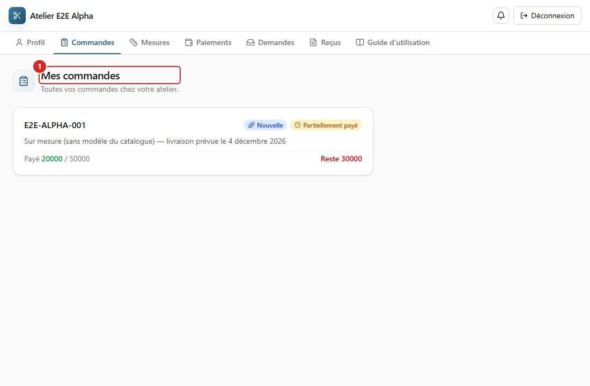
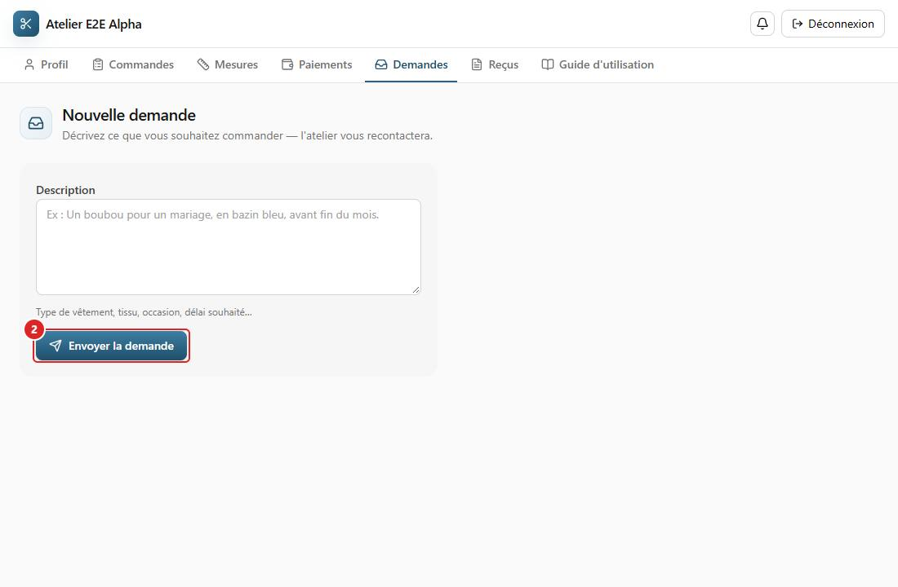
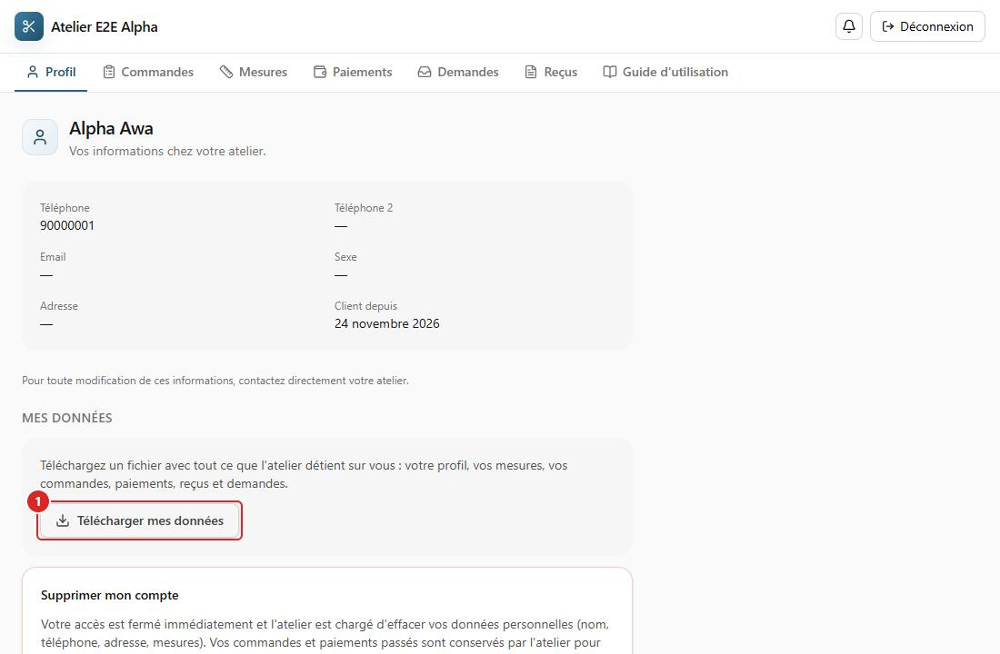

<!-- Fichier généré par `npm run guides:md` à partir du guide intégré à l'application : ne pas le modifier à la main. -->

# Guide de la cliente et du client

> Pour suivre vos commandes, vos mesures et vos paiements chez votre atelier, sans avoir à téléphoner.

Votre atelier vous donne accès à un espace personnel. Vous n'y voyez que vos propres informations. Vous ne pouvez pas les modifier vous-même (pour cela, contactez l'atelier), mais vous pouvez envoyer des demandes de commande, télécharger vos reçus et gérer vos données personnelles. Les mots entre guillemets sont les libellés exacts de l'application.

## Sommaire

1. [Activer votre compte et vous connecter](#1-activer-votre-compte-et-vous-connecter)
2. [Vous repérer](#2-vous-repérer)
3. [Suivre vos commandes et vos mesures](#3-suivre-vos-commandes-et-vos-mesures)
4. [Paiements et reçus](#4-paiements-et-reçus)
5. [Demander un nouveau vêtement](#5-demander-un-nouveau-vêtement)
6. [Vos notifications](#6-vos-notifications)
7. [Vos données personnelles](#7-vos-données-personnelles)
8. [Langue de l'espace client](#8-langue-de-lespace-client)

## 1. Activer votre compte et vous connecter

1. Votre atelier vous envoie un lien d'invitation par email, ou vous le transmet directement (WhatsApp, SMS…). Ouvrez-le, choisissez un « Mot de passe » d'au moins 8 caractères, confirmez-le avec « Confirmer le mot de passe », puis cliquez sur « Activer mon compte ». Le lien est personnel, ne sert qu'une fois et est valable 7 jours : s'il a expiré ou s'il est perdu, demandez-en un nouveau à l'atelier.
   - **Résultat attendu :** Le message « Compte activé — redirection vers votre espace… » s'affiche et vous arrivez dans votre espace.
2. Les fois suivantes, ouvrez la page de connexion et cliquez sur « Connexion client ». Saisissez votre « Numéro de téléphone » (celui que l'atelier a enregistré sur votre fiche) et votre mot de passe, puis cliquez sur « Se connecter ».
   - **Résultat attendu :** Vous arrivez dans votre espace client.
3. Si vous avez oublié votre mot de passe, cliquez sur « Mot de passe oublié ? » sur la page de connexion, saisissez votre identifiant puis cliquez sur « Envoyer le lien ». Un lien de réinitialisation est envoyé si un email est associé à votre compte ; sinon, demandez à l'atelier de vous réinviter.
   - **Résultat attendu :** Vous recevez un lien pour choisir un nouveau mot de passe.

## 2. Vous repérer

1. Sur ordinateur, les onglets du haut donnent accès à vos écrans : « Profil », « Commandes », « Mesures », « Paiements », « Demandes » et « Reçus ». Cliquez sur un onglet pour l'ouvrir.
   - **Résultat attendu :** L'écran choisi s'affiche.
2. Sur téléphone, la barre du bas donne accès au profil, aux commandes, aux mesures, aux paiements et aux demandes. Vos reçus sont dans le menu ouvert par le bouton en haut à gauche (« Ouvrir le menu »).
   - **Résultat attendu :** Tous vos écrans sont accessibles depuis le téléphone.
3. La cloche en haut à droite ouvre « Notifications » : ce qui se passe entre vous et votre atelier (commande enregistrée, changement de statut, paiement, livraison, reçu, réponse à une demande). Une pastille rouge indique le nombre de nouveautés. Cliquez sur « Lu » pour marquer une notification comme lue.
   - **Résultat attendu :** La pastille diminue à mesure que vous lisez.
4. « Profil » affiche les informations que votre atelier a enregistrées sur vous (téléphone, email, adresse). Elles ne se modifient pas ici : pour toute correction, contactez directement l'atelier.
   - **Résultat attendu :** Vous vérifiez que vos coordonnées sont à jour.

## 3. Suivre vos commandes et vos mesures

1. Ouvrez « Commandes » : chaque commande indique son statut, sa date de livraison prévue et ce qu'il reste à payer.
   - **Résultat attendu :** Vous voyez toutes vos commandes chez l'atelier.
2. Cliquez sur une commande. La fiche affiche les « Détails », les « Finances » (« Prix total », « Payé », « Reste à payer »), la liste de vos paiements et vos livraisons.
   - **Résultat attendu :** Vous savez où en est votre commande et combien il reste à payer.
3. En haut de la fiche, « Avancement de la commande » montre l'étape actuelle : « Nouvelle », « En confection », « Essayage », « Retouches », « Terminée » (prête à être récupérée) puis « Livrée ». Vous êtes aussi prévenu à chaque changement par une notification.
   - **Résultat attendu :** Quand la commande est terminée, vous pouvez venir la récupérer.
4. Ouvrez « Mesures » pour consulter l'historique des mesures prises par votre atelier. Elles sont enregistrées par l'atelier, pas par vous.
   - **Résultat attendu :** Vous retrouvez vos mesures à tout moment.

## 4. Paiements et reçus

1. Ouvrez « Paiements » pour voir l'historique de vos encaissements, toutes commandes confondues.
   - **Résultat attendu :** Vous retrouvez chaque paiement enregistré par l'atelier.
2. Ouvrez « Reçus » pour retrouver les documents émis pour vos paiements et commandes, et télécharger leur PDF.
   - **Résultat attendu :** Vous conservez une preuve de chaque paiement.
3. Dans la fiche d'une commande, cliquez sur « Générer un reçu » pour obtenir un reçu récapitulatif, puis sur « Télécharger » pour l'ouvrir.
   - **Résultat attendu :** Le message « Reçu … généré » s'affiche et le reçu est dans « Reçus ».
4. Les paiements ne se font pas dans l'application : réglez l'atelier directement (espèces, mobile money…). C'est l'atelier qui enregistre le paiement ; vous recevez alors une notification et le montant restant se met à jour.
   - **Résultat attendu :** Votre paiement apparaît dans « Paiements » dès que l'atelier l'a enregistré.

## 5. Demander un nouveau vêtement

1. Ouvrez « Demandes » puis cliquez sur « Nouvelle demande ».
   - **Résultat attendu :** Le formulaire de demande s'ouvre.
2. Décrivez ce que vous voulez dans le champ de description : type de vêtement, tissu, occasion, délai souhaité. Cliquez sur « Envoyer la demande ».
   - **Résultat attendu :** La demande est envoyée à l'atelier, qui vous recontactera ; elle apparaît dans « Demandes » avec le statut « En attente ».
3. Quand l'atelier traite votre demande, son statut devient « Acceptée » (un lien vous mène à la commande) ou « Refusée » (le motif est affiché). Vous êtes prévenu par une notification.
   - **Résultat attendu :** Vous connaissez la suite donnée à votre demande.

## 6. Vos notifications

1. Ouvrez la cloche : chaque ligne indique un événement (par exemple « Paiement » ou « Reçu »). Cliquez sur « Lu » pour la marquer comme lue.
   - **Résultat attendu :** Votre fil d'activité est à jour.

## 7. Vos données personnelles

Vous gardez la main sur ce que l'atelier détient à votre sujet.

1. Dans « Profil », descendez jusqu'à la rubrique « Mes données ».
   - **Résultat attendu :** Vous voyez les deux actions : télécharger vos données et supprimer votre compte.
2. Cliquez sur « Télécharger mes données » : vous obtenez un fichier avec tout ce que l'atelier détient sur vous (profil, mesures, commandes, paiements, reçus et demandes).
   - **Résultat attendu :** Le fichier est téléchargé sur votre appareil.
3. Pour fermer votre compte, cliquez sur « Supprimer mon compte », saisissez « Confirmez avec votre mot de passe » puis cliquez sur « Oui, supprimer définitivement ». Votre accès est fermé immédiatement et l'atelier est chargé d'effacer vos données personnelles (nom, téléphone, adresse, mesures). Vos commandes et paiements passés restent dans la comptabilité de l'atelier, sans votre identité. Pour retrouver un accès, l'atelier devra vous inviter de nouveau.
   - **Résultat attendu :** Vous êtes déconnecté et ne pouvez plus vous connecter avec ce compte ; cette action est définitive.

## 8. Langue de l'espace client

1. La page de connexion propose un bouton FR / EN. Si vous choisissez l'anglais avant de vous connecter, votre espace s'affiche en anglais, mais seulement jusqu'au prochain rechargement de la page : dans l'espace client il n'y a pas de sélecteur de langue, et c'est la langue de votre compte, le français, qui s'applique ensuite. Pour une autre langue de compte, demandez-le à votre atelier.
   - **Résultat attendu :** Vous savez que votre espace s'affiche en français, sauf pendant la session où vous avez choisi l'anglais à la connexion.
