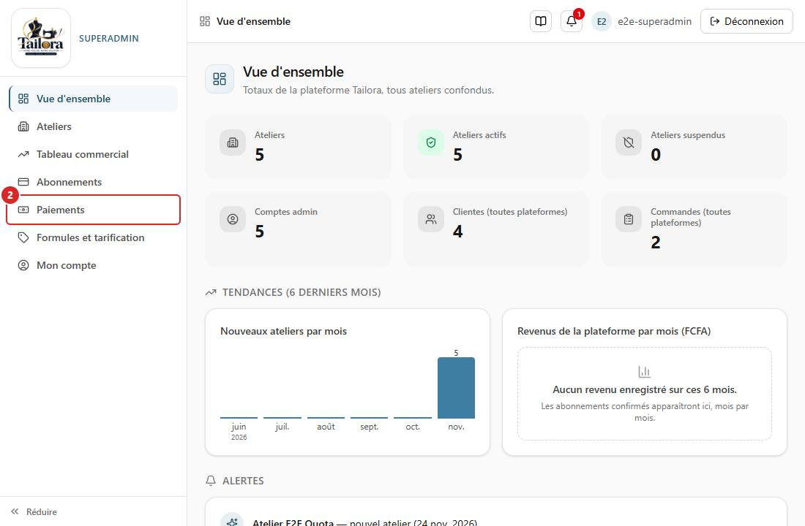
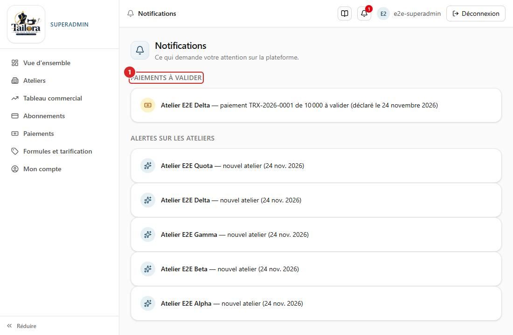
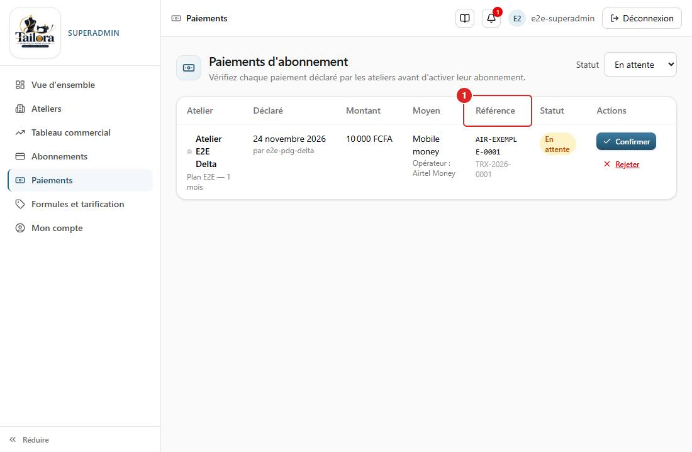
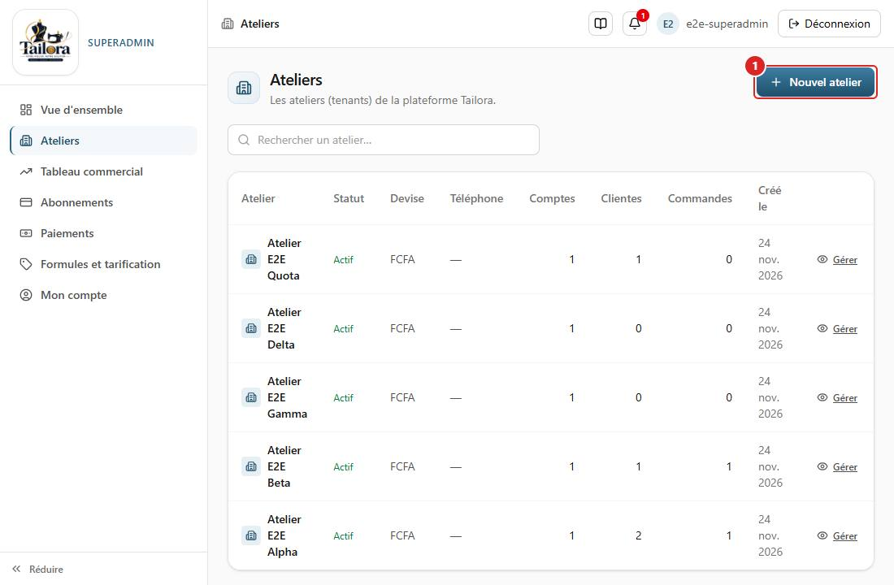
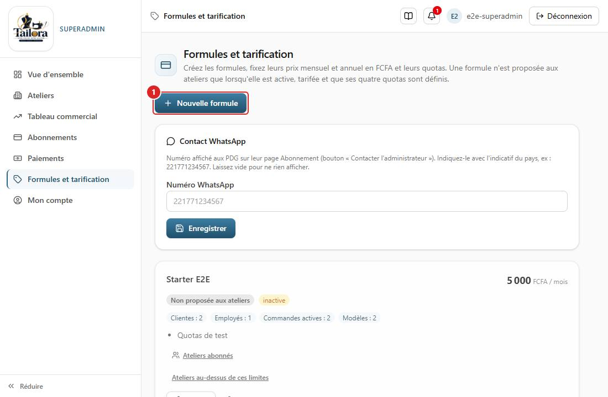

<!-- Fichier généré par `npm run guides:md` à partir du guide intégré à l'application : ne pas le modifier à la main. -->

# Guide de l'administrateur de la plateforme

> Pour le SUPERADMIN : suivre les ateliers, valider les paiements d'abonnement et fixer les formules.

Le SUPERADMIN exploite la plateforme Tailora : il ne travaille pas dans les données courantes d'un atelier (clientes, commandes…), sauf par une impersonation tracée. Les mots entre guillemets sont les libellés exacts de l'application.

## Sommaire

1. [Vous repérer](#1-vous-repérer)
2. [La cloche de notifications](#2-la-cloche-de-notifications)
3. [Valider les paiements d'abonnement](#3-valider-les-paiements-dabonnement)
4. [Gérer les ateliers](#4-gérer-les-ateliers)
5. [Se connecter en tant qu'un compte d'atelier (impersonation)](#5-se-connecter-en-tant-quun-compte-datelier-impersonation)
6. [Abonnements des ateliers](#6-abonnements-des-ateliers)
7. [Formules et tarification](#7-formules-et-tarification)
8. [Tableau commercial et réglages](#8-tableau-commercial-et-réglages)
9. [Votre compte et la langue](#9-votre-compte-et-la-langue)

## 1. Vous repérer

1. Ouvrez la page de connexion, saisissez votre « Identifiant » et votre « Mot de passe », puis cliquez sur « Se connecter ».
   - **Résultat attendu :** Vous arrivez sur la « Vue d'ensemble » de la plateforme.
2. Le menu donne accès à « Vue d'ensemble », « Ateliers », « Tableau commercial », « Abonnements », « Paiements », « Formules et tarification » et « Mon compte ». Sur téléphone, ces écrans sont dans la barre du bas. Le bouton en forme de livre de l'en-tête ouvre ce guide ; la cloche ouvre les notifications.
   - **Résultat attendu :** L'écran choisi s'affiche, son titre est rappelé dans l'en-tête.
3. Sur la « Vue d'ensemble », les totaux de la plateforme (ateliers, comptes, clientes, commandes), les tendances des six derniers mois et la section « Alertes » (abonnements expirés ou qui expirent bientôt, ateliers suspendus, nouveaux ateliers).
   - **Résultat attendu :** Vous repérez en un coup d'œil ce qui demande une action.

## 2. La cloche de notifications

1. Cliquez sur la cloche de l'en-tête : la page « Notifications » liste les « Paiements à valider » (paiements déclarés par les ateliers en attente de décision) et les « Alertes sur les ateliers ». Cliquez sur un paiement pour aller le traiter.
   - **Résultat attendu :** Vous voyez ce qui demande votre attention sur la plateforme.
2. La pastille rouge compte uniquement ce qui demande une action : paiements déclarés à valider, abonnements expirés ou qui expirent sous 7 jours. Les ateliers suspendus et les nouveaux ateliers sont listés sur la page mais ne comptent pas. Il n'y a pas de « lu / non lu » : une ligne disparaît dès que la situation est réglée, et le compteur se rafraîchit chaque minute.
   - **Résultat attendu :** Quand la pastille a disparu, plus rien n'attend votre décision.

## 3. Valider les paiements d'abonnement

Un atelier ne reçoit son accès qu'après votre vérification : aucun paiement n'est confirmé sur sa seule déclaration.

1. Ouvrez « Paiements ». Le filtre « Statut » permet d'isoler les paiements à vérifier. Chaque ligne indique l'atelier, la formule, le montant, le moyen, la « Référence » saisie par l'atelier et l'auteur de la déclaration.
   - **Résultat attendu :** Les paiements à vérifier sont en tête de liste.
2. Retrouvez la transaction sur votre relevé (mobile money, banque, caisse) : le montant et la référence doivent correspondre à la ligne.
   - **Résultat attendu :** Vous savez si le paiement est réel.
3. Si tout correspond, cliquez sur « Confirmer » puis sur « Oui, confirmer ». L'abonnement est activé et un justificatif numéroté (FAC-AAAA-NNNN) est émis ; l'atelier est prévenu par courriel. Une décision n'agit qu'une fois, même si elle est rejouée.
   - **Résultat attendu :** Le message « Décision enregistrée. » s'affiche ; le justificatif est téléchargeable via « Justificatif ».
4. Si le paiement est introuvable ou erroné, cliquez sur « Rejeter », saisissez le motif (obligatoire) puis cliquez sur « Confirmer le rejet ».
   - **Résultat attendu :** Le paiement est rejeté, aucun accès n'est accordé, et l'atelier voit le motif.
5. Pour un paiement déjà confirmé, cliquez sur « Rembourser », saisissez le motif (obligatoire) puis cliquez sur « Confirmer le remboursement ». Le remboursement est total uniquement. « Le remboursement est enregistré ici ; l'argent doit être rendu à l'atelier hors de la plateforme (sauf paiement Wave, remboursé par Wave). »
   - **Résultat attendu :** Le justificatif est marqué annulé (il est conservé) et l'abonnement est annulé.

## 4. Gérer les ateliers

1. Ouvrez « Ateliers ». Recherchez un atelier par son nom ; la colonne « Statut » indique s'il est actif ou suspendu.
   - **Résultat attendu :** Vous retrouvez l'atelier voulu.
2. Cliquez sur « Nouvel atelier », renseignez le « Nom de l'atelier », la devise, puis, dans « Premier compte ADMIN de cet atelier », un « Identifiant » et un « Mot de passe ». Cliquez sur « Créer l'atelier » et communiquez l'identifiant et le mot de passe au propriétaire.
   - **Résultat attendu :** L'atelier est créé ; son PDG peut se connecter avec cet identifiant.
3. Cliquez sur « Gérer » sur une ligne. La fiche regroupe les « Informations », les « Comptes », l'abonnement, l'« Activité récente » et l'« Historique d'impersonation ».
   - **Résultat attendu :** Vous voyez tout ce qui concerne cet atelier.
4. Pour bloquer l'accès d'un atelier, cliquez sur « Suspendre » puis sur « Oui, suspendre ». Plus aucun compte de l'atelier ne peut accéder à l'application tant que vous n'avez pas cliqué sur « Réactiver ».
   - **Résultat attendu :** L'atelier passe en « Suspendu ». Rien n'est supprimé.
5. Pour aider un propriétaire qui a perdu son accès, cliquez sur « Réinitialiser le mot de passe » sur son compte, puis sur « Générer » (ou saisissez un mot de passe d'au moins 8 caractères) et sur « Confirmer la réinitialisation ». Copiez-le avec « Copier » et transmettez-le : il n'est plus affiché une fois la fenêtre fermée.
   - **Résultat attendu :** Le propriétaire peut se reconnecter avec ce mot de passe.
6. La « Zone dangereuse » permet de supprimer un atelier : « Supprimer cet atelier » puis « Oui, supprimer ». C'est définitif et impossible dès que l'atelier contient la moindre donnée (clientes, commandes, dépenses, abonnements). Pour un atelier qui a servi, préférez « Suspendre ».
   - **Résultat attendu :** Seul un atelier totalement vide peut être supprimé.

## 5. Se connecter en tant qu'un compte d'atelier (impersonation)

À utiliser uniquement pour dépanner un atelier qui vous le demande : vous voyez l'application exactement comme son utilisateur.

1. Dans la fiche de l'atelier, section « Comptes », cliquez sur « Se connecter en tant que » sur le compte voulu, puis confirmez la question qui s'affiche.
   - **Résultat attendu :** Vous êtes dans l'application de l'atelier, sous l'identité de ce compte.
2. Un bandeau reste affiché en haut de l'écran pour vous rappeler que vous agissez sous l'identité de ce compte (avec votre nom de SUPERADMIN). La session dure 2 heures au plus. L'atelier n'est jamais limité pendant l'impersonation, même en lecture seule : agissez avec prudence, vos actions sont faites au nom du compte.
   - **Résultat attendu :** Vous pouvez reproduire et corriger le problème de l'atelier.
3. Cliquez sur « Quitter l'impersonation » dans le bandeau.
   - **Résultat attendu :** Vous retrouvez votre session SUPERADMIN.
4. Chaque impersonation est enregistrée : retrouvez-les dans la fiche de l'atelier, section « Historique d'impersonation », et dans le journal de sécurité de la plateforme.
   - **Résultat attendu :** Il reste une trace de qui s'est connecté, sur quel compte.

## 6. Abonnements des ateliers

1. Ouvrez « Abonnements » : chaque atelier y est listé avec son état (essai gratuit, actif, expiré, suspendu…), sa formule et sa date d'expiration. L'activation d'un abonnement se fait depuis la fiche de l'atelier.
   - **Résultat attendu :** Vous repérez les ateliers à relancer.
2. Dans la fiche de l'atelier, section abonnement, ouvrez « Activer un abonnement ». Choisissez « Au prix du catalogue » (formule et période au prix du catalogue, figés dans l'abonnement) ou « Activation exceptionnelle » (durée et montant saisis, motif obligatoire), puis cliquez sur « Activer l'abonnement ».
   - **Résultat attendu :** Le message « Abonnement activé. » s'affiche et l'abonnement apparaît dans l'historique.
3. Dans la même section, « Suspendre » met l'atelier en lecture seule immédiatement (motif obligatoire, réversible avec « Réactiver »), « Faire expirer » termine l'abonnement tout de suite et « Désactiver » le désactive. Chaque action est datée, signée et journalisée dans l'historique.
   - **Résultat attendu :** L'état de l'atelier est mis à jour et l'historique garde la trace.

## 7. Formules et tarification

Aucun prix n'est proposé par défaut : une formule n'est offerte aux ateliers que lorsqu'elle est active, tarifée et que ses limites sont définies.

1. Ouvrez « Formules et tarification » puis cliquez sur « Nouvelle formule ». Renseignez le nom, l'ordre d'affichage, la description et les fonctionnalités (une par ligne).
   - **Résultat attendu :** La formule est créée.
2. Dans « Tarifs (franc CFA) », saisissez le « Prix mensuel (FCFA / mois) » et le « Prix annuel (FCFA / an) » en nombres entiers. Laissez un champ vide pour ne pas proposer cette période. Définissez aussi les limites de la formule (clientes, employés, commandes actives, modèles).
   - **Résultat attendu :** Les ateliers voient les prix du catalogue ; les prix des abonnements déjà souscrits ne changent pas.
3. Cliquez sur « Activer » pour proposer la formule aux ateliers (ou « Désactiver » pour la retirer). Si l'activation est impossible (formule sans tarif ou aux limites non définies), l'application affiche les raisons juste en dessous.
   - **Résultat attendu :** La formule apparaît (ou disparaît) dans la page Abonnement des ateliers.
4. En bas de la page, la rubrique « Contact WhatsApp » permet de saisir le numéro (avec l'indicatif du pays) affiché aux PDG derrière le bouton « Contacter l'administrateur » ; cliquez sur « Enregistrer ».
   - **Résultat attendu :** Le message « Contact enregistré. » s'affiche.

## 8. Tableau commercial et réglages

1. Ouvrez « Tableau commercial » : « Revenus » (encaissé, remboursé, net), la conversion des essais, les renouvellements, les paiements à vérifier et les renouvellements à suivre.
   - **Résultat attendu :** Vous suivez l'activité commerciale de la plateforme.
2. Plus bas, la rubrique « Réglages d'abonnement » contient les « Jours de grâce après l'échéance » (accès complet après l'échéance, de 0 à 90 jours, avant la lecture seule) et les « Instructions de paiement » affichées aux ateliers qui souscrivent (numéro de paiement mobile, compte bancaire…). Enregistrez vos modifications.
   - **Résultat attendu :** Le message « Réglages enregistrés. » s'affiche et les ateliers voient vos instructions.

## 9. Votre compte et la langue

1. Ouvrez « Mon compte ». Choisissez la « Langue » : elle est enregistrée sur votre compte et s'applique à l'interface et aux courriels. Pour changer votre mot de passe, saisissez « Mot de passe actuel », le nouveau mot de passe et sa confirmation. L'espace SUPERADMIN n'a pas de bouton FR / EN dans l'en-tête : la langue se règle ici.
   - **Résultat attendu :** Le message « Mot de passe modifié. » s'affiche après un changement de mot de passe.
