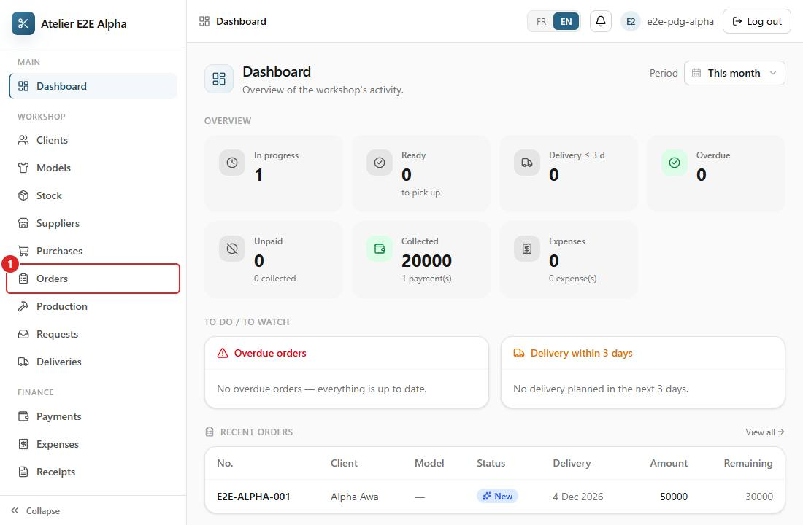
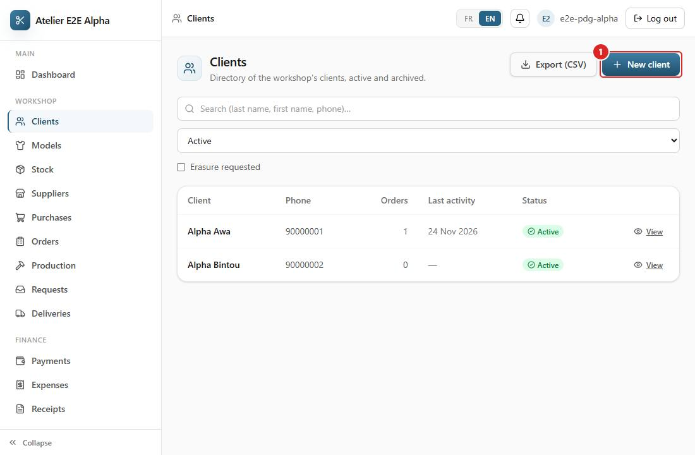
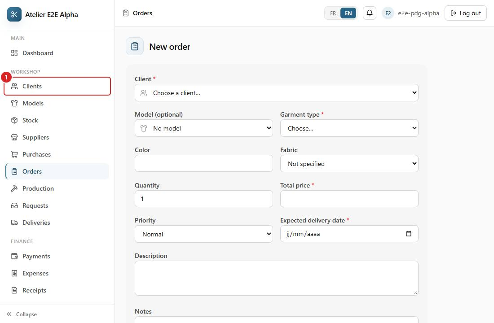
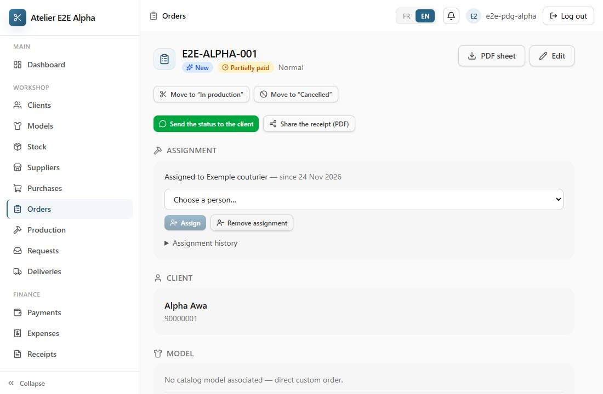
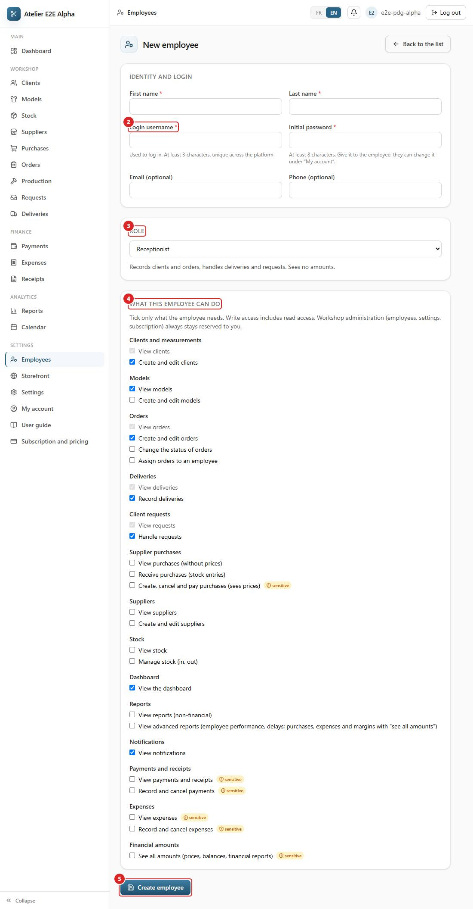
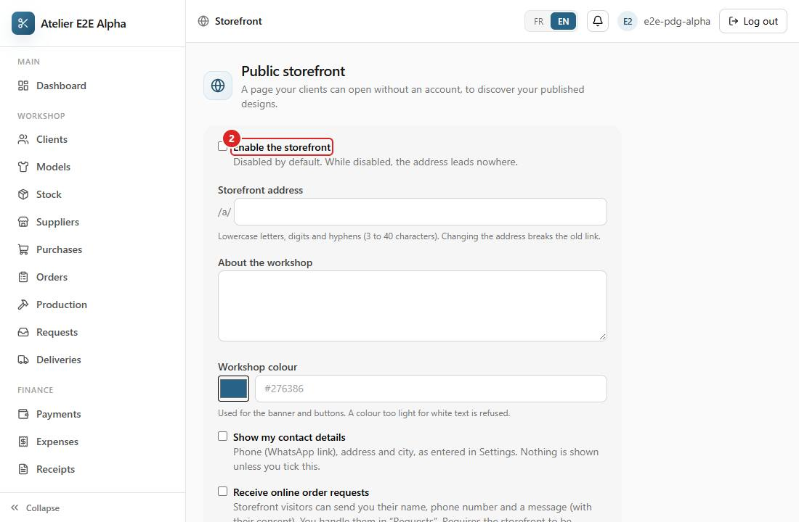
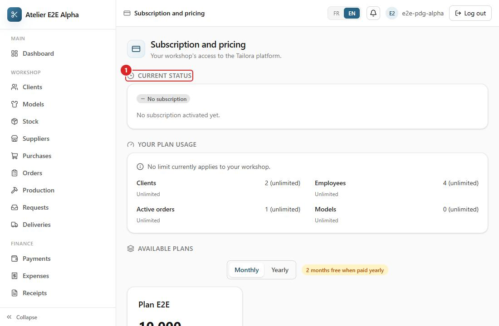

<!-- File generated by `npm run guides:md` from the guide built into the application: do not edit it by hand. -->

# Owner's guide

> For the workshop owner: from creating the account to managing your team and your subscription.

You have full rights over your workshop. This guide follows the natural order: get started, record your clients, orders and payments, then organise your team. Words in quotation marks are the exact labels used in the application.

## Contents

1. [Getting started](#1-getting-started)
2. [Finding your way around](#2-finding-your-way-around)
3. [Recording your clients and their measurements](#3-recording-your-clients-and-their-measurements)
4. [Creating and following an order](#4-creating-and-following-an-order)
5. [Taking a payment and issuing a receipt](#5-taking-a-payment-and-issuing-a-receipt)
6. [Delivering an order](#6-delivering-an-order)
7. [Handling order requests](#7-handling-order-requests)
8. [Stock, suppliers and purchases](#8-stock-suppliers-and-purchases)
9. [Expenses, reports and calendar](#9-expenses-reports-and-calendar)
10. [Creating and managing your employees](#10-creating-and-managing-your-employees)
11. [Giving a client access (client space)](#11-giving-a-client-access-client-space)
12. [Your public storefront](#12-your-public-storefront)
13. [Your subscription](#13-your-subscription)
14. [Workshop settings and password](#14-workshop-settings-and-password)

## 1. Getting started

Create your workshop once; you get a 15-day free trial with full access.

1. On the sign-in page, click « Create your workshop ». Fill in « Workshop name », « First name », « Last name » and « Email » (it is also your sign-in identifier), choose a password of at least 8 characters and confirm it, then click « Create my account ».
   - **Expected result :** Your workshop is created and you land directly in the application.
2. Next time, open the sign-in page, enter your « Username » (your email address) and « Password », then click « Sign in ». If you forget it, click « Forgot password? »: a reset link is sent to the email address linked to the account.
   - **Expected result :** You arrive on your dashboard.
3. If a banner asks you to confirm your email, open the message you received and click the link. The banner offers « Resend email » if the message did not reach you.
   - **Expected result :** Your address is confirmed and the banner disappears.

## 2. Finding your way around

The left-hand menu (computer) groups screens by area: workshop, finances, analysis and configuration.

1. Click an entry in the menu, for example « Orders », to open the matching screen. The collapse button turns the menu into an icon bar to save space.
   - **Expected result :** The screen opens and its title is shown at the top of the page.
2. On a phone, the bottom bar gives access to home, clients, models, orders and finances. The other screens (stock, production, deliveries, employees, subscription…) are in the menu opened by the button at the top left (« Open menu »).
   - **Expected result :** Every screen stays reachable, on a computer or a phone.
3. The bell in the header opens « Notifications »: automatic alerts (late orders, orders ready, upcoming deliveries, unpaid orders, low stock, late purchases). A red badge shows the number of unread alerts; select some then click « Mark as read », or use « Mark as read » on one alert.
   - **Expected result :** The badge goes down as you mark alerts as read.
4. The FR / EN button in the header changes the interface language. Your choice is saved on your account: you get it back at your next sign-in. You can also change it in « My account », under « Language ».
   - **Expected result :** Every screen and the messages sent appear in the chosen language.

## 3. Recording your clients and their measurements

An order can only be created for a client who already has measurements.

1. Open « Clients ». To find someone, type their last name, first name or phone in the search bar. Click « New client » to add one.
   - **Expected result :** The list shows your clients; each row leads to their record.
2. Fill in « Last name », « First name » and the phone (other fields are optional), then click « Save ». Add the email if you want to send them the invitation to their client space.
   - **Expected result :** The client's record opens.
3. On the record, click « New measurement ». Enter the measurements in centimetres (all optional), then save. Each measurement session creates a new entry: the history stays available on the record.
   - **Expected result :** The record shows the measurements; you can now create an order for this client.

## 4. Creating and following an order

1. Open « Orders » then click « New order ». Choose the « Client », then the « Model (optional) » if the order follows a catalogue model. Fill in the « Garment type », the « Total price », the « Priority » and the « Expected delivery date ». To take a deposit right away, tick « Collect an initial payment now ». Click « Save ».
   - **Expected result :** The order is created with the status « New »; its record shows the price, the amount collected and the balance.
2. Open the order from the list. In its record, the “Move to …” button advances the status: « New », « In production », « Fitting », « Alterations », then « Completed ». An order can also be cancelled with a mandatory reason.
   - **Expected result :** The status changes and the client signed in to their space sees the progress.
3. Open « Production » to see who works on what. In an order's record, section « Assignment », pick a person with « Choose a person… » then click « Assign ». « Remove assignment » cancels the assignment.
   - **Expected result :** The order appears in the chosen person's jobs, and they receive an alert.

## 5. Taking a payment and issuing a receipt

Payments are recorded from the order record: the Payments screen is the history.

1. Open the order and go down to the « Payments » section. Enter the amount, choose the method (cash, Mobile Money, transfer…), add a reference if you have one, then click « Add the payment ». Not possible on a cancelled order.
   - **Expected result :** The payment appears in the list, and the amount collected and the balance are updated.
2. In the same record, click « Issue a receipt » next to the payment, or « Issue a summary receipt » for a summary receipt of the order. Find all receipts in « Receipts »: open the PDF to download or print it.
   - **Expected result :** A numbered receipt is issued; the client also finds it in their space.
3. Open « Payments » to see all payments, all orders together. Filter by method or period, or search by order, client or reference.
   - **Expected result :** You quickly find a payment.

## 6. Delivering an order

1. Delivery is only possible when the order has the status « Completed »: move it to that status from its record.
   - **Expected result :** The delivery section opens in the record.
2. In the record, section « Delivery », add a « Comment » if needed. If a balance remains, tick « Collect a final payment at pick-up » and enter the amount. Click « Record the delivery ». The history of all handovers is in « Deliveries ».
   - **Expected result :** The order moves to « Delivered » and the delivery is dated.

## 7. Handling order requests

Requests come from the client space and from the public storefront.

1. Open « Requests » and click a pending request to read the description, the wanted model and the contact details.
   - **Expected result :** The request detail appears with the « Handle the request » section.
2. Accepting a request does not create the order: create it first with « New order » (see above), then, in the request, pick it with « Link to an existing order » and click « Accept and link ». If the request comes from the storefront and the person has no record yet, first click « Create the client record ».
   - **Expected result :** The request moves to « Accepted » and the client is notified.
3. To decline, click « Refuse this request », enter the « Reason for refusal (optional) » if you wish, then click « Confirm refusal ».
   - **Expected result :** The request moves to « Refused » with the reason, visible to the client.
4. To receive requests from visitors without an account, enable them in « Storefront » (see “Your public storefront”). Without follow-up, a visitor's request is deleted automatically.
   - **Expected result :** Storefront requests arrive in the same list, with a « Storefront » badge.

## 8. Stock, suppliers and purchases

1. Open « Stock » then « New item ». Fill in the name, category, unit, the « Alert threshold » (you are alerted when the quantity drops to that level) and the « Initial quantity ».
   - **Expected result :** The item appears in the list; the initial quantity is recorded as the first movement.
2. In an item's record, section « Movement », choose « Entry » or « Exit », enter the quantity (and the « Reason », mandatory for an exit), then click « Record the entry » or « Record the exit ».
   - **Expected result :** The stock quantity is updated and the movement is added to the history with its author.
3. Open « Suppliers » then « New supplier » to record where you buy fabrics and supplies.
   - **Expected result :** The supplier is available when creating a purchase.
4. Open « Purchases » then « New purchase ». Choose the supplier, the « Expected delivery date », add each item with « Add an item » (quantity and unit price), then click « Save purchase ».
   - **Expected result :** The purchase is recorded as « To receive » and followed in the list.
5. When the goods arrive, open the purchase, enter the quantity received in « Received now » (or click « Receive everything ») then « Record receipt ».
   - **Expected result :** Stock increases automatically; the purchase becomes « Partially received » or « Received ».
6. To pay the purchase, click « Record payment » then confirm with « Yes, record ». « Cancel purchase » is possible as long as nothing is received or paid.
   - **Expected result :** A “Supplier purchases” expense of the same amount is created automatically.

## 9. Expenses, reports and calendar

1. Open « Expenses » then « New expense ». Fill in the « Category », the « Amount » and, if needed, the « Date » (today otherwise) and a « Description », then save.
   - **Expected result :** The expense appears in the list and in the cash result.
2. Open « Reports » to follow your finances: choose the « Period », then read « Collected », « Expenses » and « Cash flow balance ». This is not an accounting profit: it is money collected minus expenses.
   - **Expected result :** The figures follow the chosen period.
3. Open « Calendar »: orders are placed on their planned delivery date. Click a day to see its orders or create one.
   - **Expected result :** You see the busy days at a glance.

## 10. Creating and managing your employees

Only the owner manages employees, settings and the subscription: these rights cannot be delegated.

1. Open « Employees ». The list shows everyone's role, status and number of rights. Click « New employee » to add someone.
   - **Expected result :** The creation form opens.
2. In « Identity and login », fill in « First name », « Last name », a « Login username » (3 characters minimum, unique on the platform) and an « Initial password » (8 characters minimum). Give both to the employee: they can change their password in « My account ».
   - **Expected result :** The employee will be able to sign in with this identifier.
3. In « Role », choose a role (tailor, receptionist, storekeeper, accountant, other) then click « Apply this role's rights »: this ticks the usual rights of the role. The role is a starting template: it gives no right by itself.
   - **Expected result :** The role's rights are ticked; you can adjust them.
4. In « What this employee can do », tick only what the employee needs: writing includes reading. Rights that give access to money are marked « sensitive »: when you grant them, the application asks you to enter « Your password (confirmation) ».
   - **Expected result :** The employee will only see the screens matching the ticked rights.
5. Click « Create employee ».
   - **Expected result :** The message « Employee created. » appears and the employee can sign in.
6. To edit an employee, click « Manage » on their row. Changing the role does not remove rights already granted: check them. « Reset password » closes their open sessions; « Deactivate account » prevents them from signing in without deleting anything, and « Reactivate account » reverses that.
   - **Expected result :** Changes are immediate: a deactivated employee is signed out.

## 11. Giving a client access (client space)

1. Open the client's record and click « Invite this client », then « Confirm invitation ». If the record has an email, the invitation link is sent to it; otherwise the application shows the link: click « Copy » and pass it on yourself (WhatsApp, SMS…).
   - **Expected result :** A client account is created; the record shows “Active client account” once the account is activated.
2. The invitation link is personal, single-use and valid for 7 days. After that, or if the client lost it, renew the invitation from their record.
   - **Expected result :** The client chooses their password and signs in to their space with their phone number.
3. A client can close their account and ask for their personal data to be erased. The record then shows « This client closed their account and asked for their data to be erased. »: click « Anonymise this client » then « Anonymise permanently ». Their identity (name, phone, measurements…) is permanently erased; orders and payments remain in your accounts, without their identity.
   - **Expected result :** The record is anonymised; this action cannot be undone.

## 12. Your public storefront

A page open to everyone, without an account, that presents your published models. It is disabled by default.

1. In a model's record, add photos, then click « Publish in the lookbook ». Only published models are shown: never prices or client data.
   - **Expected result :** The model shows « Published: this model can be shown to clients. ».
2. Open « Storefront », tick « Enable the storefront », choose the « Storefront address » (lowercase letters, digits and hyphens), write the « About the workshop » and, if you wish, tick « Show my contact details » and « Receive online order requests ». Save.
   - **Expected result :** The message « Saved. » appears and the storefront is online.
3. Click « Copy link » to copy the address, or « Open » to visit it. Changing the address invalidates the old link.
   - **Expected result :** You can share the address with your clients.

## 13. Your subscription

The free trial lasts 15 days. After that, access continues with a subscription paid outside the application and checked by the platform.

1. Open « Subscription and pricing ». « Current status » shows your situation (free trial, active, expired…), the plan, the expiry and the days left. Available plans and their monthly and yearly prices are listed below, with a FAQ.
   - **Expected result :** You know until when your access is secured.
2. Above the list of plans, choose the period « Monthly » or « Yearly », then click « Subscribe » on the wanted plan. Read « How to pay »: these are the platform's instructions (mobile payment number, account…). Make the payment outside the application.
   - **Expected result :** You have paid and keep the transaction reference.
3. Back on the page, choose the « Payment method », the « Operator » if requested, enter the « Payment reference » (transaction number from the SMS or statement, 3 characters minimum) then click « Declare my payment ».
   - **Expected result :** The message « Payment declared. The platform will verify it; you will be notified by email. » appears. No extra access is granted before the check.
4. Until the platform has checked, the payment stays « Pending » and you cannot declare another; « Withdraw my declaration » cancels the declaration. Once « Confirmed », the subscription is activated, you receive an email and can open the receipt with « Download ». A « Rejected » payment shows its reason.
   - **Expected result :** The subscription starts now, or at the end of the current one if you renew early: no day is lost.
5. When the trial or subscription ends, you keep full access for a few grace days (warning banner), then the workshop becomes read-only: you view and export your data but cannot create new data. Nothing is deleted. A new subscription restores access. For any question, click « Contact the administrator ».
   - **Expected result :** Your data stays intact, whatever the subscription situation.

## 14. Workshop settings and password

1. Open « Settings »: edit the workshop's « Workshop name », « Currency », « Slogan » and « Logo ». The « Receipts & payment information » section lets you add “Key: Value” lines (mobile payment number, bank details, legal notices…) that appear on every PDF receipt. Also choose the light or dark « Theme ».
   - **Expected result :** The message « Saved. » appears and future receipts reflect the changes.
2. Open « My account ». Choose the « Language »; to change your password, enter « Current password », the new password and its confirmation.
   - **Expected result :** The message « Password updated. » appears.
