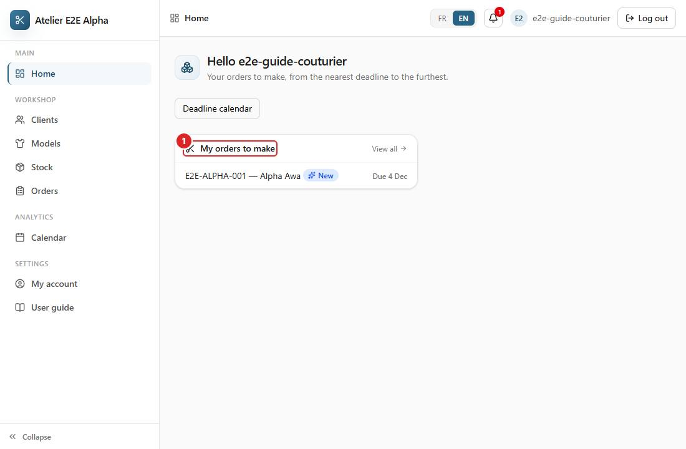
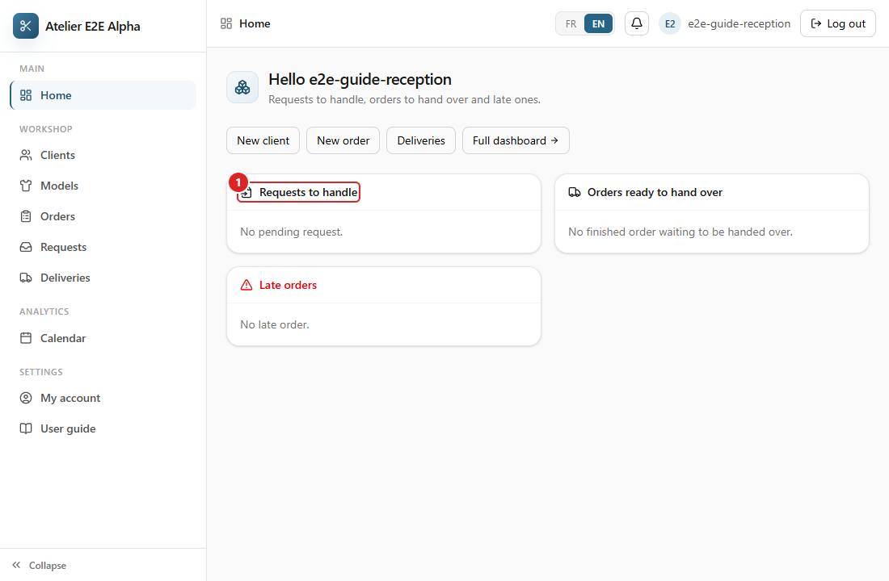
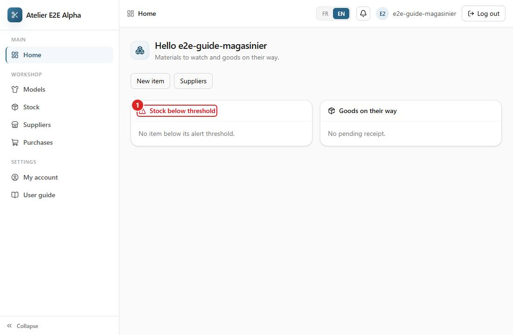
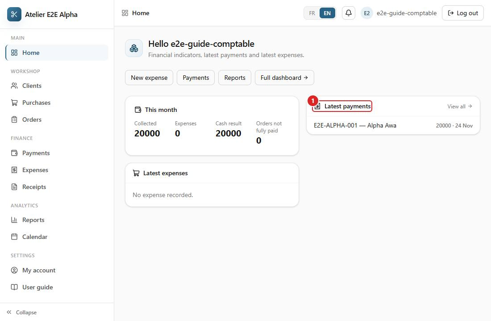

<!-- File generated by `npm run guides:md` from the guide built into the application: do not edit it by hand. -->

# Employee guide

> For members of a workshop team: tailor, receptionist, storekeeper, accountant or another role.

Your manager (the owner) created an account for you with an identifier and a password. This guide only shows what your rights allow you to do: if a screen is missing from your menu, your account has no access to it. Words in quotation marks are the exact labels used in the application.

> In the application, an employee only sees the sections and steps matching their rights; this document presents them all, with the required rights.

## Contents

1. [Getting started](#1-getting-started)
2. [Tailor: your orders to make](#2-tailor-your-orders-to-make)
3. [Receptionist: clients and orders](#3-receptionist-clients-and-orders)
4. [Receptionist: order requests](#4-receptionist-order-requests)
5. [Receptionist: handing over an order](#5-receptionist-handing-over-an-order)
6. [Storekeeper: stock, suppliers and receipts](#6-storekeeper-stock-suppliers-and-receipts)
7. [Accountant: payments, expenses and reports](#7-accountant-payments-expenses-and-reports)
8. [“Other” role](#8-other-role)

## 1. Getting started

*Required rights :* View notifications

1. Open the sign-in page, enter the identifier and password given by your manager, then click « Sign in ». You land on your home page, the workspace of your role. The menu only offers the screens you are entitled to.
   - **Expected result :** Your home page shows the information useful for your work.
2. Your rights are set individually by the owner: two people with the same role may therefore see different screens. If you need a screen that is missing from your menu, ask your manager. An access-denied message is also a matter of rights.
   - **Expected result :** You know who to ask when you lack an access.
3. The bell in the header opens « Notifications »: automatic alerts that concern you. A red badge shows unread alerts; select some then click « Mark as read », or use « Mark as read » on one alert.
   - **Expected result :** The badge goes down as you read your alerts.
4. Open « My account »: choose the « Language » and, to change your password, enter « Current password », the new password and its confirmation. The FR / EN button in the header also changes the language; it is saved on your account.
   - **Expected result :** The message « Password updated. » appears after a password change.
5. If the workshop's subscription has ended, a banner appears and the workshop becomes read-only: you can view everything but save nothing. Tell your manager; no data is lost.
   - **Expected result :** As soon as the subscription is renewed, everything works again.

## 2. Tailor: your orders to make

Your home page lists the orders assigned to you, from the nearest deadline to the furthest.

*Required rights :* Change the status of orders

1. On the home page, find the « My orders to make » section. Late orders carry the mention « Late ». Click an order to open it.
   - **Expected result :** The order record opens.
2. To see all orders, open « Orders »: filter by status or priority, or search by number or client. In the record, read the model, fabric, colour, description and the « Expected delivery ».
   - **Expected result :** You have everything you need to make the garment.
3. In the order record, the « Client measurements » section shows the client's measurements; « Full history » opens all her measurement sessions.
   - **Expected result :** You have the measurements in front of you.
4. As work progresses, click the “Move to …” button in the record: « In production » when you start, « Fitting » when the client must try it on, « Alterations » if corrections are needed, then « Completed » when the garment is ready.
   - **Expected result :** The status changes; reception sees the order ready for delivery and the client follows the progress.

## 3. Receptionist: clients and orders

Your home page shows the requests to handle, the orders ready for delivery and the late ones.

*Required rights :* Create and edit clients ; Create and edit orders

1. On the home page, read « Requests to handle », « Orders ready to hand over » and « Late orders ». « View all » opens the full list.
   - **Expected result :** You know what needs your attention today.
2. Open « Clients » then « New client ». Fill in « Last name », « First name » and the phone, then click « Save ».
   - **Expected result :** The client's record opens.
3. On the record, click « New measurement », enter the measurements in centimetres (all optional) and save. Without measurements, the order cannot be created.
   - **Expected result :** The measurements appear on the record.
4. Open « Orders » then « New order ». Choose the « Client », fill in the « Garment type », the « Expected delivery date » and any useful details, then click « Save ».
   - **Expected result :** The order is created with the status « New ». Taking payment is up to the person allowed to record payments.

## 4. Receptionist: order requests

*Required rights :* View requests ; Handle requests ; View orders

1. Open « Requests » and click a pending request to read the description and contact details.
   - **Expected result :** The detail appears with the « Handle the request » section.
2. Accepting a request does not create the order: create it first with « New order », then, in the request, pick it with « Link to an existing order » and click « Accept and link ».
   - **Expected result :** The request moves to « Accepted » and the client is notified.
3. To decline, click « Refuse this request », enter the « Reason for refusal (optional) » if you wish, then « Confirm refusal ».
   - **Expected result :** The request moves to « Refused » with the reason.

## 5. Receptionist: handing over an order

*Required rights :* Record deliveries ; View orders

1. Finished orders waiting for handover are on the home page, in « Orders ready to hand over ». The history of handovers is in « Deliveries ».
   - **Expected result :** You find the orders to hand over.
2. Open the order: delivery is only possible with the status « Completed ». In the « Delivery » section, add a « Comment » if needed, then click « Record the delivery ». If a balance is still due, the person allowed to take payments records it.
   - **Expected result :** The order moves to « Delivered » and the handover is dated.

## 6. Storekeeper: stock, suppliers and receipts

Your home page shows the stock under its threshold and the goods expected. Prices are hidden unless a special right is granted.

*Required rights :* Manage stock (in, out) ; Create and edit suppliers ; Receive purchases (stock entries)

1. On the home page, the « Stock below threshold » section lists the items to restock. Click an item to see its record.
   - **Expected result :** You know what to order first.
2. Open « Stock » then « New item ». Fill in the name, category, unit, the « Alert threshold » and the « Initial quantity », then save.
   - **Expected result :** The item appears in the list.
3. In an item's record, section « Movement », choose « Entry » or « Exit », enter the quantity (and the « Reason », mandatory for an exit), then click « Record the entry » or « Record the exit ».
   - **Expected result :** The quantity is updated and the movement is added to the history, with your name.
4. Open « Suppliers » then « New supplier » to add a supplier (name, contact, phone).
   - **Expected result :** The supplier is saved.
5. When goods arrive, open « Purchases », open the purchase concerned, enter the quantity in « Received now » (or click « Receive everything ») then « Record receipt ».
   - **Expected result :** Stock increases automatically and the purchase becomes « Partially received » or « Received ».

## 7. Accountant: payments, expenses and reports

Your home page shows the month's indicators, the latest payments and the latest expenses.

*Required rights :* View payments and receipts ; See all amounts (prices, balances, financial reports) ; Record and cancel payments ; View orders ; Record and cancel expenses ; View reports (non-financial)

1. On the home page, read « Latest payments » and « Latest expenses ».
   - **Expected result :** You see the recent financial activity.
2. Open the order concerned, section « Payments ». Enter the amount, the method, a reference if you have one, then click « Add the payment ». Not possible on a cancelled order.
   - **Expected result :** The payment appears, and the amount collected and the balance are updated.
3. Open « Receipts » to find issued receipts and open their PDF. In an order record, « Issue a receipt » issues the receipt of a payment.
   - **Expected result :** A numbered receipt is available for the client.
4. Open « Expenses » then « New expense ». Fill in the « Category », the « Amount », the date and a description, then save.
   - **Expected result :** The expense appears in the list and in the cash result.
5. Open « Reports », choose the « Period » then read « Collected », « Expenses » and « Cash flow balance ».
   - **Expected result :** The figures follow the chosen period.

## 8. “Other” role

1. Your account first only gives access to notifications. Your home page shows the screens the owner opened for you: if more are added, they appear in your menu and this guide gains the matching sections.
   - **Expected result :** You only see what has been granted to you.
