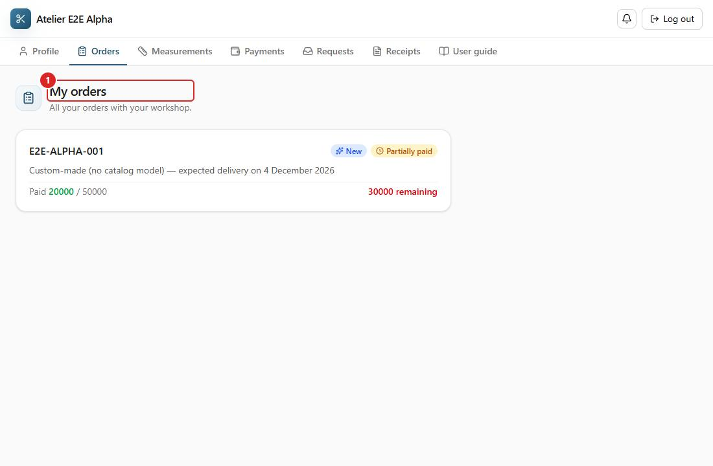
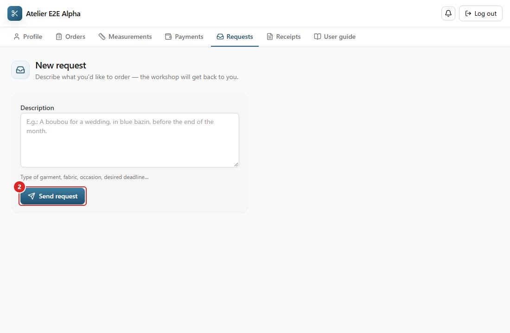
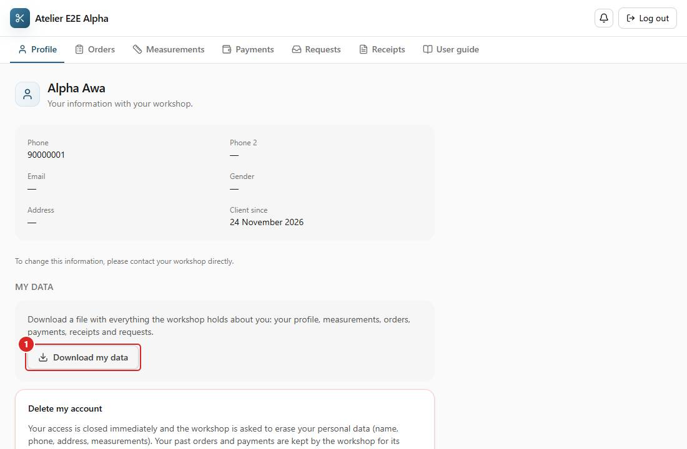

<!-- File generated by `npm run guides:md` from the guide built into the application: do not edit it by hand. -->

# Client guide

> To follow your orders, measurements and payments at your workshop, without having to phone.

Your workshop gives you access to a personal space. You only see your own information. You cannot edit it yourself (contact the workshop for that), but you can send order requests, download your receipts and manage your personal data. Words in quotation marks are the exact labels used in the application.

## Contents

1. [Activating your account and signing in](#1-activating-your-account-and-signing-in)
2. [Finding your way around](#2-finding-your-way-around)
3. [Following your orders and measurements](#3-following-your-orders-and-measurements)
4. [Payments and receipts](#4-payments-and-receipts)
5. [Asking for a new garment](#5-asking-for-a-new-garment)
6. [Your notifications](#6-your-notifications)
7. [Your personal data](#7-your-personal-data)
8. [Language of the client space](#8-language-of-the-client-space)

## 1. Activating your account and signing in

1. Your workshop sends you an invitation link by email, or passes it on directly (WhatsApp, SMS…). Open it, choose a « Password » of at least 8 characters, confirm it with « Confirm password », then click « Activate my account ». The link is personal, works only once and is valid for 7 days: if it expired or is lost, ask the workshop for a new one.
   - **Expected result :** The message « Account activated — redirecting to your space… » appears and you land in your space.
2. Next time, open the sign-in page and click « Client sign-in ». Enter your « Phone number » (the one the workshop recorded on your record) and your password, then click « Sign in ».
   - **Expected result :** You arrive in your client space.
3. If you forgot your password, click « Forgot password? » on the sign-in page, enter your identifier then click « Send the link ». A reset link is sent if an email is linked to your account; otherwise, ask the workshop to invite you again.
   - **Expected result :** You receive a link to choose a new password.

## 2. Finding your way around

1. On a computer, the tabs at the top give access to your screens: « Profile », « Orders », « Measurements », « Payments », « Requests » and « Receipts ». Click a tab to open it.
   - **Expected result :** The chosen screen appears.
2. On a phone, the bottom bar gives access to profile, orders, measurements, payments and requests. Your receipts are in the menu opened by the button at the top left (« Open menu »).
   - **Expected result :** All your screens are reachable from the phone.
3. The bell at the top right opens « Notifications »: what happens between you and your workshop (order recorded, status change, payment, delivery, receipt, answer to a request). A red badge shows the number of new items. Click « Read » to mark a notification as read.
   - **Expected result :** The badge goes down as you read.
4. « Profile » shows the information your workshop recorded about you (phone, email, address). It cannot be edited here: for any correction, contact the workshop directly.
   - **Expected result :** You check that your details are up to date.

## 3. Following your orders and measurements

1. Open « Orders »: each order shows its status, its planned delivery date and what is left to pay.
   - **Expected result :** You see all your orders at the workshop.
2. Click an order. The record shows the « Details », the « Finances » (« Total price », « Paid », « Remaining to pay »), the list of your payments and your deliveries.
   - **Expected result :** You know where your order stands and how much is left to pay.
3. At the top of the record, « Order progress » shows the current step: « New », « In production », « Fitting », « Alterations », « Completed » (ready to collect) then « Delivered ». You are also notified of each change.
   - **Expected result :** When the order is finished, you can come and collect it.
4. Open « Measurements » to see the history of measurements taken by your workshop. They are recorded by the workshop, not by you.
   - **Expected result :** You find your measurements at any time.

## 4. Payments and receipts

1. Open « Payments » to see the history of your payments, all orders together.
   - **Expected result :** You find every payment recorded by the workshop.
2. Open « Receipts » to find the documents issued for your payments and orders, and download their PDF.
   - **Expected result :** You keep a proof of each payment.
3. In an order's record, click « Generate a receipt » to get a summary receipt, then « Download » to open it.
   - **Expected result :** The message “Receipt … generated” appears and the receipt is in « Receipts ».
4. Payments are not made in the application: pay the workshop directly (cash, mobile money…). The workshop records the payment; you then receive a notification and the remaining amount updates.
   - **Expected result :** Your payment appears in « Payments » as soon as the workshop has recorded it.

## 5. Asking for a new garment

1. Open « Requests » then click « New request ».
   - **Expected result :** The request form opens.
2. Describe what you want in the description field: type of garment, fabric, occasion, wanted deadline. Click « Send request ».
   - **Expected result :** The request is sent to the workshop, which will contact you; it appears in « Requests » with the status « Pending ».
3. When the workshop handles your request, its status becomes « Accepted » (a link takes you to the order) or « Refused » (the reason is shown). You are notified.
   - **Expected result :** You know what happened to your request.

## 6. Your notifications

1. Open the bell: each line shows an event (for example « Payment » or « Receipt »). Click « Read » to mark it as read.
   - **Expected result :** Your activity feed is up to date.

## 7. Your personal data

You stay in control of what the workshop holds about you.

1. In « Profile », go down to the « My data » section.
   - **Expected result :** You see the two actions: download your data and delete your account.
2. Click « Download my data »: you get a file with everything the workshop holds about you (profile, measurements, orders, payments, receipts and requests).
   - **Expected result :** The file is downloaded to your device.
3. To close your account, click « Delete my account », enter « Confirm with your password » then click « Yes, delete permanently ». Your access is closed immediately and the workshop is responsible for erasing your personal data (name, phone, address, measurements). Your past orders and payments stay in the workshop's accounts, without your identity. To regain access, the workshop must invite you again.
   - **Expected result :** You are signed out and can no longer sign in with this account; this is final.

## 8. Language of the client space

1. The sign-in page offers an FR / EN button. If you choose English before signing in, your space is shown in English, but only until the page is next reloaded: there is no language selector in the client space, and your account's language, French, applies afterwards. For another account language, ask your workshop.
   - **Expected result :** You know your space is shown in French, except during the session where you chose English at sign-in.
