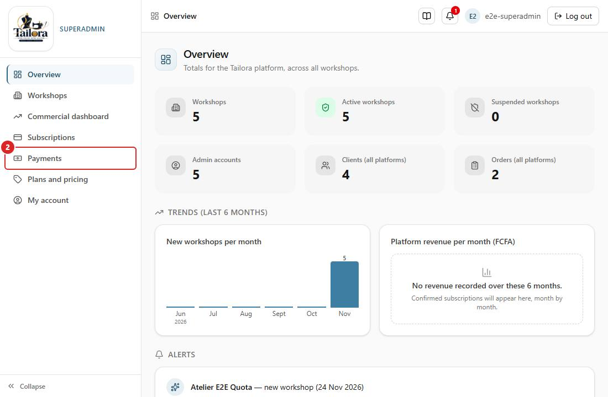
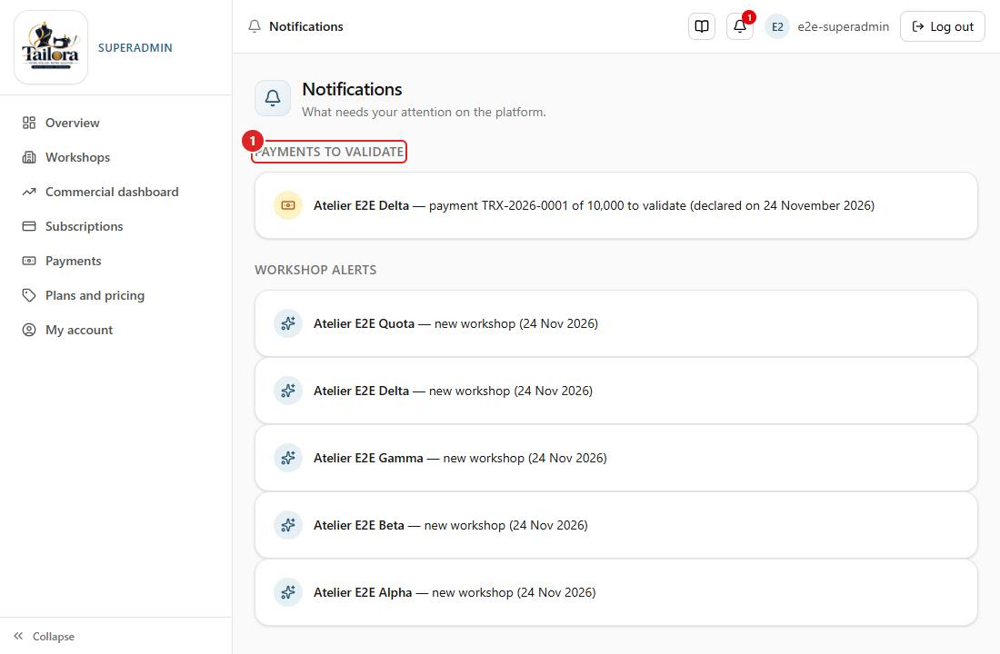
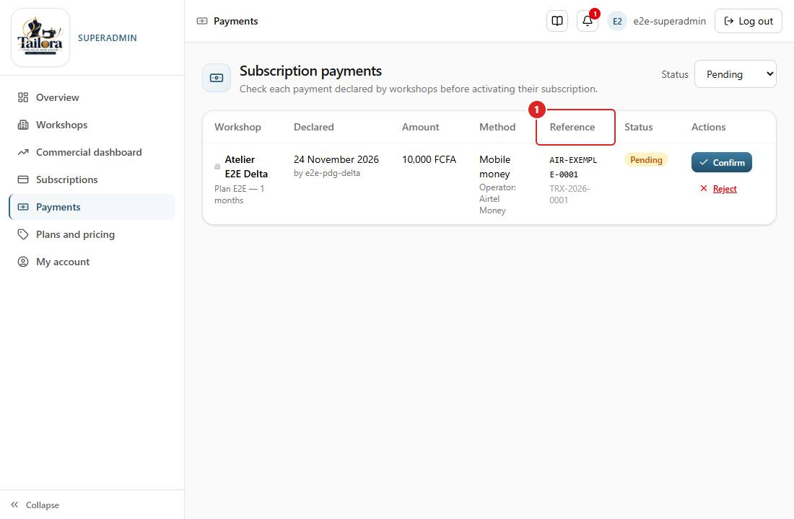
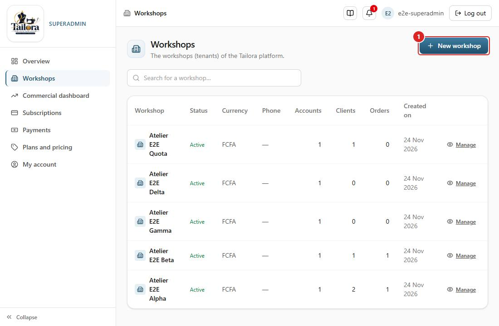
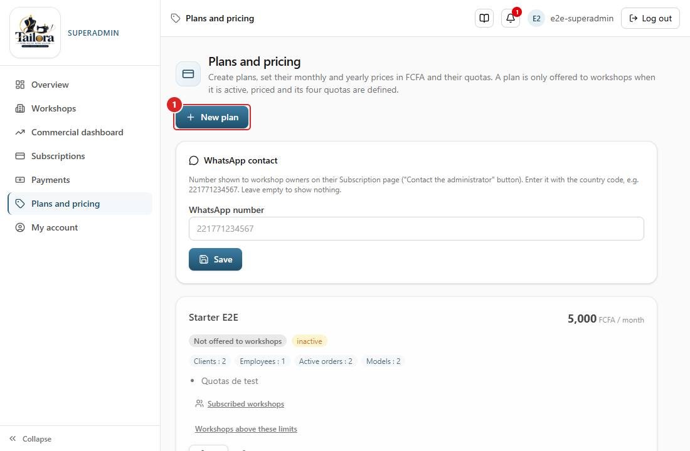

<!-- File generated by `npm run guides:md` from the guide built into the application: do not edit it by hand. -->

# Platform administrator guide

> For the SUPERADMIN: follow the workshops, validate subscription payments and set the plans.

The SUPERADMIN runs the Tailora platform: it does not work in a workshop's day-to-day data (clients, orders…), except through a traced impersonation. Words in quotation marks are the exact labels used in the application.

## Contents

1. [Finding your way around](#1-finding-your-way-around)
2. [The notification bell](#2-the-notification-bell)
3. [Validating subscription payments](#3-validating-subscription-payments)
4. [Managing workshops](#4-managing-workshops)
5. [Signing in as a workshop account (impersonation)](#5-signing-in-as-a-workshop-account-impersonation)
6. [Workshop subscriptions](#6-workshop-subscriptions)
7. [Plans and pricing](#7-plans-and-pricing)
8. [Commercial dashboard and settings](#8-commercial-dashboard-and-settings)
9. [Your account and language](#9-your-account-and-language)

## 1. Finding your way around

1. Open the sign-in page, enter your « Username » and « Password », then click « Sign in ».
   - **Expected result :** You arrive on the platform « Overview ».
2. The menu gives access to « Overview », « Workshops », « Commercial dashboard », « Subscriptions », « Payments », « Plans and pricing » and « My account ». On a phone, these screens are in the bottom bar. The book-shaped button in the header opens this guide; the bell opens notifications.
   - **Expected result :** The chosen screen appears, its title is repeated in the header.
3. On the « Overview », the platform totals (workshops, accounts, clients, orders), the trends of the last six months and the « Alerts » section (expired or soon-expiring subscriptions, suspended workshops, new workshops).
   - **Expected result :** You spot at a glance what needs action.

## 2. The notification bell

1. Click the bell in the header: the « Notifications » page lists the « Payments to validate » (payments declared by workshops awaiting a decision) and the « Workshop alerts ». Click a payment to go and handle it.
   - **Expected result :** You see what needs your attention on the platform.
2. The red badge only counts what needs action: declared payments to validate, subscriptions expired or expiring within 7 days. Suspended workshops and new workshops are listed on the page but do not count. There is no “read / unread”: a line disappears as soon as the situation is settled, and the counter refreshes every minute.
   - **Expected result :** When the badge is gone, nothing is waiting for your decision.

## 3. Validating subscription payments

A workshop only gets its access after your check: no payment is confirmed on its declaration alone.

1. Open « Payments ». The « Status » filter isolates payments to check. Each row shows the workshop, plan, amount, method, the « Reference » entered by the workshop and who declared it.
   - **Expected result :** Payments to check are at the top of the list.
2. Find the transaction on your statement (mobile money, bank, cash): the amount and reference must match the row.
   - **Expected result :** You know whether the payment is real.
3. If everything matches, click « Confirm » then « Yes, confirm ». The subscription is activated and a numbered receipt (FAC-YYYY-NNNN) is issued; the workshop is notified by email. A decision only acts once, even if replayed.
   - **Expected result :** The message « Decision recorded. » appears; the receipt can be downloaded via « Receipt ».
4. If the payment cannot be found or is wrong, click « Reject », enter the reason (mandatory) then click « Confirm rejection ».
   - **Expected result :** The payment is rejected, no access is granted, and the workshop sees the reason.
5. For an already confirmed payment, click « Refund », enter the reason (mandatory) then click « Confirm refund ». Refunds are total only. « The refund is recorded here; the money must be returned to the workshop outside the platform (except Wave payments, refunded by Wave). »
   - **Expected result :** The receipt is marked cancelled (it is kept) and the subscription is cancelled.

## 4. Managing workshops

1. Open « Workshops ». Search a workshop by name; the « Status » column shows whether it is active or suspended.
   - **Expected result :** You find the workshop you want.
2. Click « New workshop », fill in the « Workshop name », the currency, then, in « First ADMIN account for this workshop », an « Username » and a « Password ». Click « Create workshop » and give the identifier and password to the owner.
   - **Expected result :** The workshop is created; its owner can sign in with this identifier.
3. Click « Manage » on a row. The record gathers the « Information », the « Accounts », the subscription, the « Recent activity » and the « Impersonation history ».
   - **Expected result :** You see everything about this workshop.
4. To block a workshop's access, click « Suspend » then « Yes, suspend ». No account of the workshop can use the application until you click « Reactivate ».
   - **Expected result :** The workshop becomes « Suspended ». Nothing is deleted.
5. To help an owner who lost access, click « Reset password » on their account, then « Generate » (or type a password of at least 8 characters) and « Confirm reset ». Copy it with « Copy » and pass it on: it is no longer shown once the window is closed.
   - **Expected result :** The owner can sign in again with this password.
6. The « Danger zone » lets you delete a workshop: « Delete this workshop » then « Yes, delete ». It is final and impossible as soon as the workshop holds any data (clients, orders, expenses, subscriptions). For a workshop that has been used, prefer « Suspend ».
   - **Expected result :** Only a completely empty workshop can be deleted.

## 5. Signing in as a workshop account (impersonation)

Use it only to help a workshop that asks you to: you see the application exactly as its user does.

1. In the workshop's record, section « Accounts », click « Sign in as » on the wanted account, then confirm the question shown.
   - **Expected result :** You are in the workshop's application, under that account's identity.
2. A banner stays at the top of the screen to remind you that you are acting under this account's identity (with your SUPERADMIN name). The session lasts 2 hours at most. The workshop is never restricted during impersonation, even when read-only: act carefully, your actions are made in the account's name.
   - **Expected result :** You can reproduce and fix the workshop's problem.
3. Click « Exit impersonation » in the banner.
   - **Expected result :** You get your SUPERADMIN session back.
4. Every impersonation is recorded: find them in the workshop's record, section « Impersonation history », and in the platform's security log.
   - **Expected result :** A trace remains of who signed in, on which account.

## 6. Workshop subscriptions

1. Open « Subscriptions »: each workshop is listed with its state (free trial, active, expired, suspended…), plan and expiry date. A subscription is activated from the workshop's record.
   - **Expected result :** You spot the workshops to follow up.
2. In the workshop's record, subscription section, open « Activate a subscription ». Choose « At catalogue price » (plan and period at the catalogue price, frozen in the subscription) or « Exceptional activation » (duration and amount entered, reason mandatory), then click « Activate subscription ».
   - **Expected result :** The message « Subscription activated. » appears and the subscription shows in the history.
3. In the same section, « Suspend » puts the workshop in read-only mode immediately (reason mandatory, reversible with « Reactivate »), « Expire now » ends the subscription right away and « Deactivate » disables it. Every action is dated, signed and logged in the history.
   - **Expected result :** The workshop's state is updated and the history keeps the trace.

## 7. Plans and pricing

No price is offered by default: a plan is only offered to workshops once it is active, priced and its limits are defined.

1. Open « Plans and pricing » then click « New plan ». Fill in the name, display order, description and features (one per line).
   - **Expected result :** The plan is created.
2. In « Prices (CFA franc) », enter the « Monthly price (FCFA / month) » and the « Yearly price (FCFA / year) » as whole numbers. Leave a field empty to not offer that period. Also set the plan's limits (clients, employees, active orders, models).
   - **Expected result :** Workshops see the catalogue prices; the prices of subscriptions already taken do not change.
3. Click « Activate » to offer the plan to workshops (or « Deactivate » to withdraw it). If activation is impossible (plan with no price or undefined limits), the application shows the reasons just below.
   - **Expected result :** The plan appears (or disappears) on the workshops' Subscription page.
4. At the bottom of the page, the « WhatsApp contact » section lets you enter the number (with country code) shown to owners behind the “Contact the administrator” button; click « Save ».
   - **Expected result :** The message « Contact saved. » appears.

## 8. Commercial dashboard and settings

1. Open « Commercial dashboard »: « Revenue » (collected, refunded, net), trial conversion, renewals, payments to check and renewals to follow.
   - **Expected result :** You follow the platform's commercial activity.
2. Further down, the « Subscription settings » section holds the « Grace days after expiry » (full access after the due date, from 0 to 90 days, before read-only) and the « Payment instructions » shown to subscribing workshops (mobile payment number, bank account…). Save your changes.
   - **Expected result :** The message « Settings saved. » appears and workshops see your instructions.

## 9. Your account and language

1. Open « My account ». Choose the « Language »: it is saved on your account and applies to the interface and emails. To change your password, enter « Current password », the new password and its confirmation. The SUPERADMIN space has no FR / EN button in the header: the language is set here.
   - **Expected result :** The message « Password updated. » appears after a password change.
